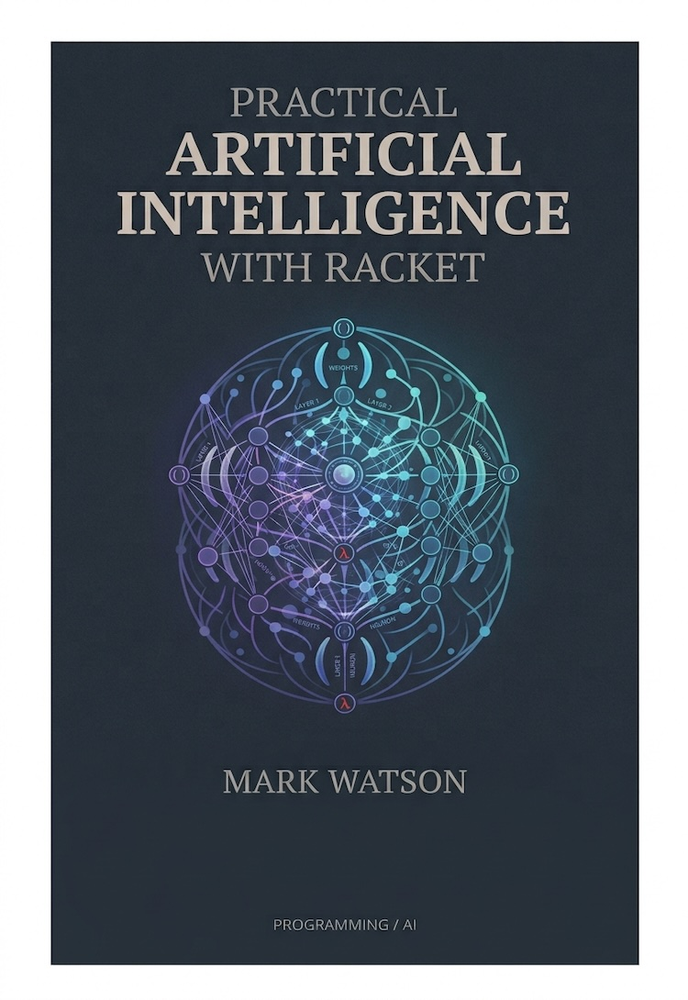

# Example code and book manuscript for Mark Watson's book "Practical Artificial Intelligence Development With Racket"

Racket implementations of many short AI examples: LLM clients and agents, embeddings and RAG, deep learning, reinforcement learning, NLP, the semantic web, and rule-based systems.

Dear readers, I hope you enjoy these examples!

Link to book on LeanPub:

[https://leanpub.com/racket-ai](https://leanpub.com/racket-ai)

Read this book in the manuscript subdirectory:

[manuscript/TOC.md](./manuscript/TOC.md)

## Example code for "Practical Artificial Intelligence Development With Racket"

The code is contained in the same repository as the manuscript, but in the subdirectory **source-code**:

[Source code](./source-code/README.md)

### License for Book Manuscript: Creative Commons

Copyright 2022-2026 Mark Watson. All rights reserved.

This book may be shared using the Creative Commons "share and share alike, no modifications, no commercial reuse" license.

### License for Book Example Source Code: Apache 2

Copyright 2022-2026 Mark Watson. All rights reserved.

Find the text of the Apache 2 license here: [https://www.apache.org/licenses/LICENSE-2.0.txt](https://www.apache.org/licenses/LICENSE-2.0.txt)

One example is licensed differently: `source-code/coding-agent-harness` is released under AGPL-3.0 (see the `LICENSE` file in that directory).

## Getting started with the example code

1. Install [Racket](https://racket-lang.org).
2. Install the two packages most examples use: `raco pkg install --auto http-easy html-parsing`
3. From the `source-code` directory, run `make compile` and then `make test`. Neither needs an API key or a network connection.

[source-code/README.md](./source-code/README.md) lists every example with its chapter, extra packages, and the environment variables (API keys) it needs.

## Repository layout

- `manuscript/` holds the book text; `manuscript/Book.txt` is the chapter order.
- `source-code/` holds the examples.
- `SOURCE_CODE_MAP.md` maps each chapter to its example directories. It and `manuscript/TOC.md` are generated by `racket tools/make-index.rkt`.
- `TODO.md` is a list of suggested improvements to the book and the examples.

Pull requests with corrections to either the code or the manuscript are welcome.
