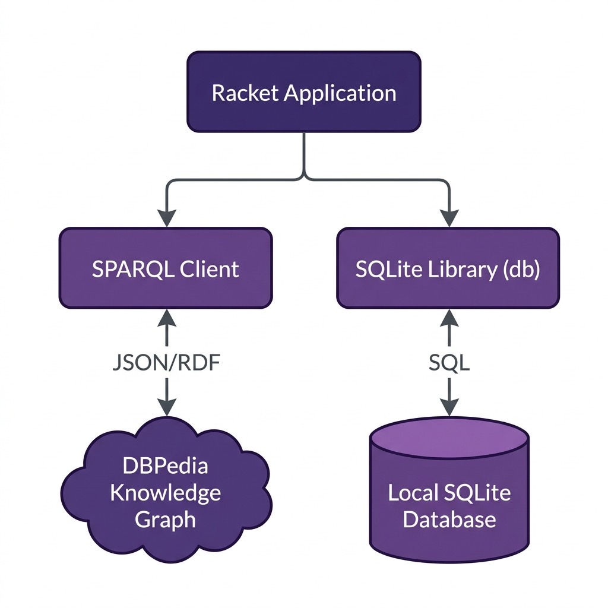

# Datastores

For my personal research projects the only datastores that I often use are the embedded relational database and Resource Description Framework (RDF) datastores that might be local to my laptop or public Knowledge Graphs like DBpedia and WikiData. The use of RDF data and the SPARQL query language is part of the fields of the semantic web and linked data.


## Accessing public RDF Knowledge Graphs - a DBpedia example

I will not cover RDF data and the SPARQL query language in great detail here. For a longer treatment please read the RDF and SPARQL tutorial material in my Common Lisp book: [Loving Common Lisp, or the Savvy Programmer's Secret Weapon](https://leanpub.com/lovinglisp/read#leanpub-auto-semantic-web-and-linked-data). The following short background is enough to follow the code in this chapter and the next one.

### Just enough RDF and SPARQL

RDF data is a set of *triples*. Each triple is a statement with three parts: a subject, a predicate, and an object. Subjects and predicates are URIs, written inside angle brackets. An object is either another URI or a literal value like a string or a number:

```
<http://dbpedia.org/resource/Steve_Jobs>
    <http://xmlns.com/foaf/0.1/name>
    "Steve Jobs"@en .
```

This triple says that the thing identified by the first URI has the name "Steve Jobs", and the **@en** tag says that the string is in English. Because the object of one triple can be the subject of another, a collection of triples forms a graph, which is where the term Knowledge Graph comes from.

A SPARQL query is a pattern with variables, which are names that start with a question mark. The query engine finds every way of filling in the variables so that the pattern matches triples in the datastore:

```sparql
SELECT ?person ?comment {
  ?person <http://xmlns.com/foaf/0.1/name> "Steve Jobs"@en .
  ?person <http://www.w3.org/2000/01/rdf-schema#comment> ?comment .
  FILTER (lang(?comment) = 'en')
}
```

The two patterns share the variable **?person**, so a result must satisfy both: something named "Steve Jobs" that also has a comment. The **FILTER** line keeps only English comments. The queries in this chapter also use **OPTIONAL** (keep the result even if this part does not match) and **UNION** (match either of two patterns).

### A SPARQL client for DBpedia

The following listing shows the file **Racket-AI-book/source-code/sparql/sparql.rkt**. It queries DBpedia's public SPARQL endpoint for information about a person or place and converts the reply into Racket lists. Here is what each function does:

- **sparql-escape-string** prepares a name typed by a user for use inside a quoted SPARQL string. Without it, a name that contains a double quote character would end the string early and break the query.
- **sparql-dbpedia-person-uri** takes a person's name and builds a query for the URIs and comments of everything with that name. **sparql-dbpedia-place-uri** does the same for places.
- **sparql-dbpedia-for-person** takes a person URI (including the angle brackets) and builds a query for a comment and for web sites associated with that person.
- **sparql-query->hash** sends a query to the endpoint and converts the JSON reply to a Racket hash table with **string->jsexpr**. A busy public endpoint sometimes replies with an HTML error page, so this function raises an error that shows the start of the reply when the reply is not JSON.
- **json->listvals** pulls the variable bindings out of the reply, giving one list per query variable.
- **gd** turns those per-variable lists into one list per result row.
- **sparql-dbpedia** is the function you will usually call: it runs a query and returns the rows.

The file starts with **#lang at-exp racket**. The *at-exp* reader adds a syntax for text with embedded Racket values, which is convenient for query templates. In the form **@string-append{...}** everything between the curly braces is literal text, except that **@name** inserts the value of the variable **name**. The odd looking **@"@"** is how you write a literal at sign, which SPARQL needs for the language tag **@en**.

```racket
#lang at-exp racket

;;; sparql.rkt — A small SPARQL client for the DBpedia public endpoint
;;; Apache 2 License

(provide sparql-dbpedia-for-person
         sparql-dbpedia-person-uri
         sparql-dbpedia-place-uri
         sparql-escape-string
         sparql-query->hash
         json->listvals
         extract-name-uri-and-comment
         gd
         sparql-dbpedia
         *sparql-endpoint*)

(require net/url)
(require net/uri-codec)
(require json)
(require racket/pretty)

;; The endpoint is a parameter so you can point the same code at another
;; SPARQL service, for example https://query.wikidata.org/sparql
(define *sparql-endpoint* (make-parameter "https://dbpedia.org/sparql"))

;; Names typed by a user go inside a quoted SPARQL literal. Escape the
;; characters that would end the literal early or break the query.
(define (sparql-escape-string s)
  (let* ([s (string-replace s "\\" "\\\\")]
         [s (string-replace s "\"" "\\\"")]
         [s (string-replace s "\n" "\\n")]
         [s (string-replace s "\r" "\\r")])
    s))

(define (sparql-dbpedia-for-person person-uri)
  @string-append{
     SELECT
      (GROUP_CONCAT(DISTINCT ?website; SEPARATOR="  |  ")
                                   AS ?website) ?comment {
      OPTIONAL {
        { @person-uri <http://www.w3.org/2000/01/rdf-schema#comment> ?comment . FILTER (lang(?comment) = 'en') }
        UNION
        { @person-uri <http://dbpedia.org/ontology/description> ?comment . FILTER (lang(?comment) = 'en') }
      } .
      OPTIONAL {
        @person-uri
        <http://dbpedia.org/ontology/wikiPageExternalLink>
        ?website
         . FILTER( !regex(str(?website), "dbpedia", "i"))
      }
     } LIMIT 4})

(define (sparql-dbpedia-person-uri person-name)
  (define name (sparql-escape-string person-name))
  @string-append{
    SELECT DISTINCT ?personuri ?comment {
      ?personuri
        <http://xmlns.com/foaf/0.1/name>
        "@name"@"@"en .
      {
        ?personuri <http://www.w3.org/2000/01/rdf-schema#comment> ?comment .
        FILTER (lang(?comment) = 'en')
      } UNION {
        ?personuri <http://dbpedia.org/ontology/description> ?comment .
        FILTER (lang(?comment) = 'en')
      }
}})

(define (sparql-dbpedia-place-uri place-name)
  (define name (sparql-escape-string place-name))
  @string-append{
    SELECT DISTINCT ?placeuri ?comment {
      ?placeuri
        <http://xmlns.com/foaf/0.1/name>
        "@name"@"@"en .
      {
        ?placeuri <http://www.w3.org/2000/01/rdf-schema#comment> ?comment .
        FILTER (lang(?comment) = 'en')
      } UNION {
        ?placeuri <http://dbpedia.org/ontology/description> ?comment .
        FILTER (lang(?comment) = 'en')
      }
}})

;; Send a query and return the JSON reply as a hash table. A busy public
;; endpoint sometimes answers with an HTML error page instead of JSON, so
;; a reply that does not parse raises an error that says what came back.
(define (sparql-query->hash query)
  (define reply
    (call/input-url
     (string->url
      (string-append
       (*sparql-endpoint*)
       "?query="
       (uri-encode query)))
     get-pure-port
     port->string
     '("Accept: application/json")))
  (with-handlers
      ([exn:fail:read?
        (lambda (e)
          (error 'sparql-query->hash
                 "endpoint did not return JSON; reply starts with: ~a"
                 (substring reply 0 (min 200 (string-length reply)))))])
    (define result (string->jsexpr reply))
    (unless (hash? result)
      (error 'sparql-query->hash "unexpected JSON reply: ~a" result))
    result))

;; One list per query variable; each element is (variable-name value)
(define (json->listvals a-hash)
  (let* ([head (hash-ref a-hash 'head (hash))]
         [vars (hash-ref head 'vars '())]
         [results (hash-ref a-hash 'results (hash))]
         [bindings (hash-ref results 'bindings '())])
    (for/list ([var vars])
      (for/list ([bc bindings])
        (let* ([var-sym (string->symbol var)]
               [var-info (hash-ref bc var-sym (hash))]
               [a-value (hash-ref var-info 'value "")])
          (list var a-value))))))

;; Turn the per-variable lists into one list per result row. "Zipping"
;; with (apply map list ...) works for any number of query variables.
(define (gd data)
  (let ([jd (json->listvals data)])
    (if (null? jd)
        '()
        (apply map list jd))))

;; Used by the Knowledge Graph Navigator: pair up the values of the
;; first two query variables as (uri comment) lists
(define (extract-name-uri-and-comment l1 l2)
  (map (lambda (a b) (list (second a) (second b)))
       l1 l2))

(define (sparql-dbpedia sparql)
  (gd (sparql-query->hash sparql)))

(module+ main
  ;; (pretty-print (sparql-dbpedia (sparql-dbpedia-person-uri "Steve Jobs")))
  ;; (pretty-print (sparql-dbpedia (sparql-dbpedia-for-person "<http://dbpedia.org/resource/Steve_Jobs>")))
  (void))
```

The function **gd** is short but worth a second look. If **json->listvals** returns the lists (a1 a2) for the first variable and (b1 b2) for the second, then **(apply map list ...)** pairs them up as ((a1 b1) (a2 b2)), one list per result row. This works for any number of query variables.

Let's try an example in a Racket REPL:

```racket
> (require "sparql.rkt")
> (sparql-dbpedia (sparql-dbpedia-person-uri "Steve Jobs"))
'((("personuri" "http://dbpedia.org/resource/Steve_Jobs_(book)")
   ("comment" "2011 authorized biography by Walter Isaacson"))
  (("personuri" "http://dbpedia.org/resource/Steve_Jobs")
   ("comment"
    "American entrepreneur; co-founder of Apple Inc. (1955–2011)")))
```

DBpedia is rebuilt from Wikipedia from time to time, so the results you see will probably differ from mine. Notice that the name "Steve Jobs" matched a book as well as a person. The Knowledge Graph Navigator application in a later chapter shows the user a list to choose from when this happens.

In practice, I start exploring data on DBpedia using the SPARQL query web app [https://dbpedia.org/sparql](https://dbpedia.org/sparql). I experiment with different SPARQL queries for whatever application I am working on and then embed those queries in my Racket, Common Lisp, [Clojure](https://leanpub.com/clojureai/read#leanpub-auto-clojure-wrapper-for-the-jena-rdf-and-sparql-library) (link to read my Clojure AI book free online), and other programming languages I use.

In addition to using DBpedia I often also use the WikiData public Knowledge Graph and local RDF data stores hosted on my laptop with Apache Jena. The endpoint in **sparql.rkt** is the parameter **\*sparql-endpoint\***, so you can point the same code at another SPARQL service with **parameterize**. One of the practice problems at the end of this chapter asks you to try this with WikiData.

The directory also contains **tests.rkt**, which checks the result-processing functions against a saved JSON reply. You can run it without a network connection using **raco test tests.rkt**.

## SQLite

Racket's standard **db** library supports SQLite, so there is no package to install. The following listing shows the file **sqlite.rkt** in the directory **Racket-AI-book/source-code/misc_code**:

```racket
#lang racket

;;; sqlite.rkt — Using SQLite through Racket's built-in db library
;;; Apache 2 License

(require db)

(provide open-person-db add-person! find-person update-person-age!)

;; Open (creating if needed) a database and make sure the table exists.
;; Pass 'memory for a throwaway in-memory database.
(define (open-person-db [db-file "test.db"])
  (define conn (sqlite3-connect #:database db-file #:mode 'create))
  (query-exec conn
              "create table if not exists person
                 (name varchar(30) primary key, age integer, email varchar(40))")
  conn)

;; Always pass values as query parameters (the ? placeholders) and never
;; build SQL by pasting strings together: parameters are escaped for you.
(define (add-person! conn name age email)
  (query-exec conn
              "insert or replace into person values (?, ?, ?)"
              name age email))

;; query-maybe-row returns one row as a vector, or #f when nothing matches.
(define (find-person conn name)
  (query-maybe-row conn "select * from person where name = ?" name))

(define (update-person-age! conn name new-age)
  (query-exec conn "update person set age = ? where name = ?" new-age name))

(module+ main
  (define conn (open-person-db 'memory))
  (add-person! conn "Mary" 34 "mary@test.com")
  ;; A transaction: either both inserts happen or neither does.
  (call-with-transaction
   conn
   (lambda ()
     (add-person! conn "Carlos" 51 "carlos@test.com")
     (add-person! conn "Ana" 28 "ana@test.com")))
  (println (query-rows conn "select * from person order by name"))
  (println (find-person conn "Mary"))
  (update-person-age! conn "Mary" 35)
  (println (find-person conn "Mary"))
  (println (find-person conn "Nobody"))
  (println (query-value conn "select count(*) from person"))
  (disconnect conn))

(module+ test
  (require rackunit)
  (define conn (open-person-db 'memory))
  (add-person! conn "Mary" 34 "mary@test.com")
  (check-equal? (find-person conn "Mary") (vector "Mary" 34 "mary@test.com"))
  (update-person-age! conn "Mary" 35)
  (check-equal? (vector-ref (find-person conn "Mary") 1) 35)
  (check-false (find-person conn "Nobody"))
  ;; a name containing a quote is safe because it is a parameter
  (add-person! conn "O'Brien" 40 "ob@test.com")
  (check-equal? (query-value conn "select count(*) from person") 2)
  (disconnect conn))
```

The function **open-person-db** uses **sqlite3-connect** to open a database file. The **#:mode 'create** keyword argument creates the file if it does not exist, and the **create table if not exists** statement makes the function safe to call on a database that already has the table. Passing **'memory** instead of a file name gives a database that lives only in memory, which is what the example and the tests use.

There are four things to notice in the rest of the code:

- Values are passed as query parameters. Each question mark in the SQL text is replaced by the corresponding extra argument to **query-exec**. Never build SQL by pasting strings together, because a value containing a quote character, like the name O'Brien in the test, would break the statement or worse.
- **query-exec** runs a statement that returns no rows, **query-rows** returns a list of rows with each row a vector, **query-maybe-row** returns one row or **#f**, and **query-value** returns a single value.
- **call-with-transaction** runs a function inside a transaction. If the function raises an error then none of its changes are kept.
- The **test** submodule at the end runs with **raco test sqlite.rkt**.

Running the file prints:

```
$ racket sqlite.rkt
'(#("Ana" 28 "ana@test.com")
  #("Carlos" 51 "carlos@test.com")
  #("Mary" 34 "mary@test.com"))
'#("Mary" 34 "mary@test.com")
'#("Mary" 35 "mary@test.com")
#f
3
```

The following diagram shows the high-level architecture of the datastore integrations developed in this chapter:

{width: "100%"}


## Optional practice problems

1. Extend the SQLite example: add a function that deletes a person by name and a function that returns everyone older than a given age, both using query parameters. Add a test for each to the **test** submodule.
2. Query WikiData: use **parameterize** to bind **\*sparql-endpoint\*** to `https://query.wikidata.org/sparql` and run a simple query such as `SELECT ?s ?p ?o { ?s ?p ?o } LIMIT 3`. WikiData asks clients to identify themselves, so you may need to add a `User-Agent` header next to the `Accept` header in **sparql-query->hash**.
3. DBpedia location search: write a function `sparql-dbpedia-for-city` that queries DBpedia for a city's name (e.g., "Paris" or "Tokyo"), returning its URI, country, and population, using SPARQL query templates.
