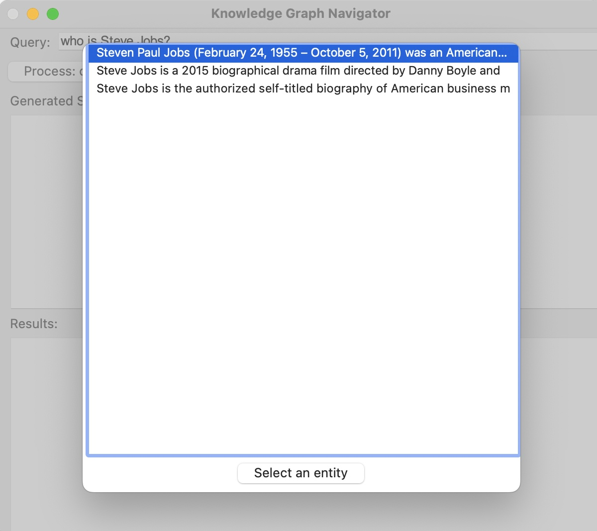
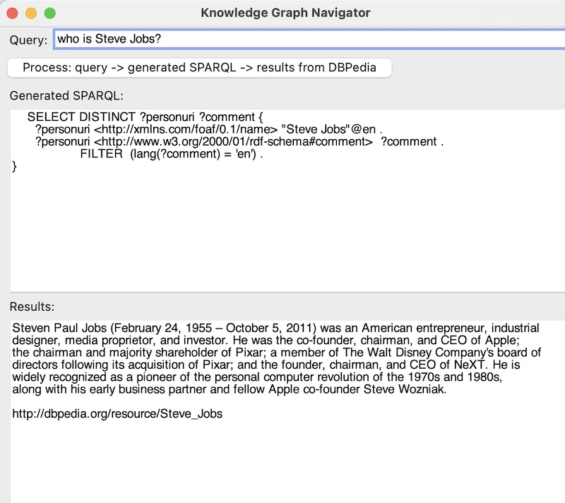
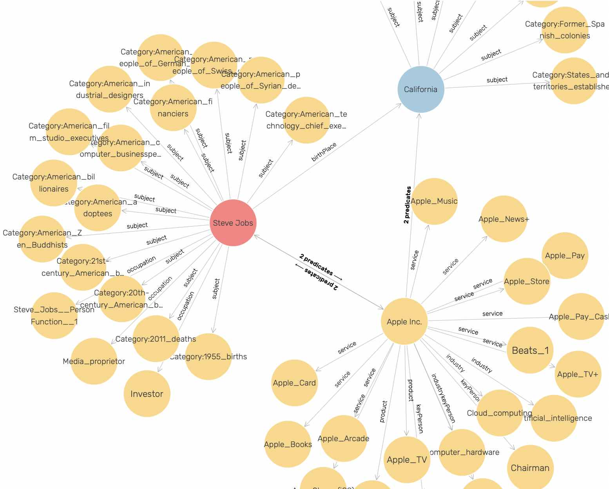
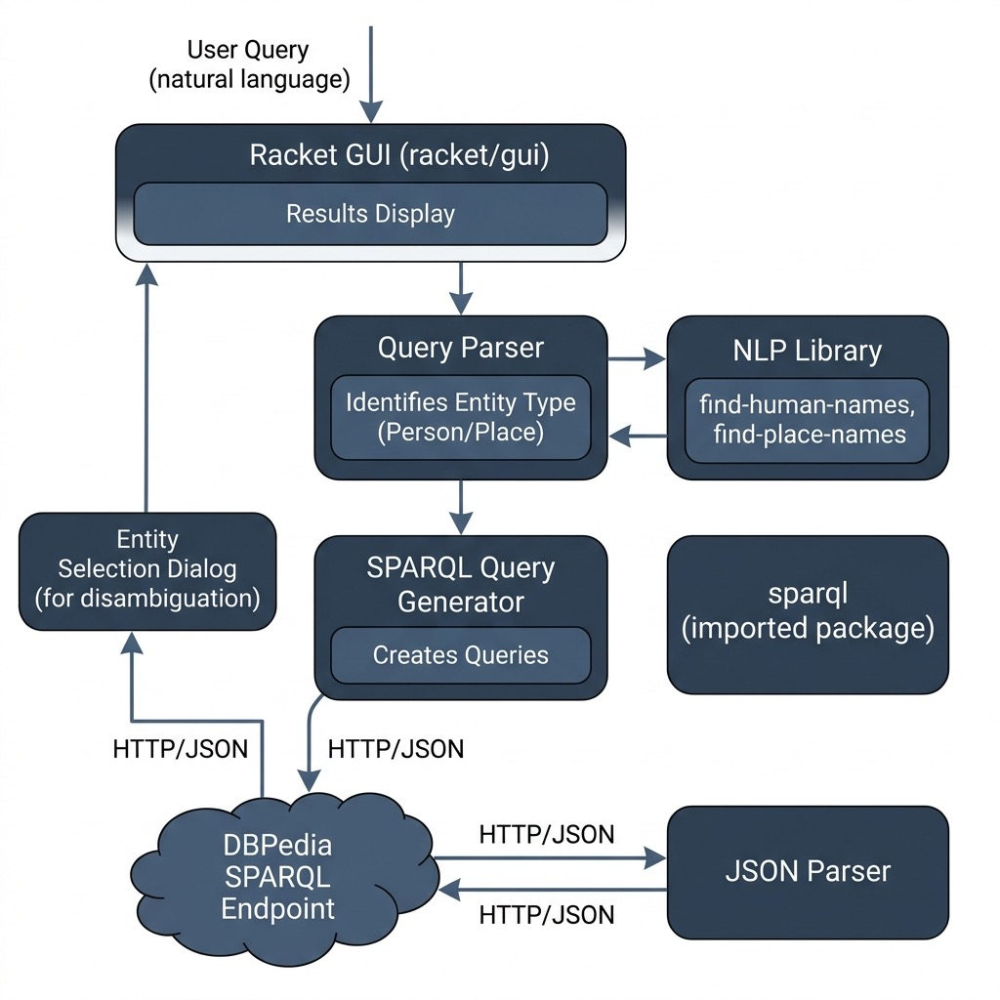

# Knowledge Graph Navigator {#kgn}

The Knowledge Graph Navigator (which I will often refer to as KGN) is a tool for processing a set of entity names and automatically exploring the public Knowledge Graph [DBPedia](http://dbpedia.org) using SPARQL queries. I started to write KGN for my own use to automate some things I used to do manually when exploring Knowledge Graphs, and later thought that KGN might be also useful for educational purposes. KGN shows the user the auto-generated SPARQL queries so hopefully the user will learn by seeing examples.

I cover SPARQL and linked data/Knowledge Graphs in previous books I have written. The chapter **Datastores** in this book has a short background section, and for more details please see either of the following:

- The chapter **Knowledge Graph Navigator** in my book **Loving Common Lisp, or the Savvy Programmer's Secret Weapon**
- The chapters **Background Material for the Semantic Web and Knowledge Graphs**, **Knowledge Graph Navigator** in my book **Practical Artificial Intelligence Programming With Clojure**

We use the Natural Language Processing (NLP) library from the last chapter to find human and place names in input text and then construct SPARQL queries to access data from DBPedia.

The Racket version of KGN is deliberately small: it answers "who is ..." questions about people and "where is ..." questions about places. The following screenshots show the application:

{width: "30%"}


I have implemented parts of KGN in several languages: Common Lisp, Java, Clojure, Racket Scheme, Swift, Python, and Hy. The most full featured version of KGN, including a full user interface, is featured in my book [Loving Common Lisp, or the Savvy Programmer's Secret Weapon](https://leanpub.com/lovinglisp) that you can read free online. That version performs more speculative SPARQL queries to find information compared to the example here that I designed for ease of understanding, and modification. I am not covering the basics of RDF data and SPARQL queries here. While I provide sufficient background material to understand the code, please read the relevant chapters in my Common Lisp book for more background material.

{width: "30%"}



We will be running an example using data containing three person entities, one company entity, and one place entity. The following figure shows a very small part of the DBPedia Knowledge Graph that is centered around these entities. The data for this figure was collected by an example Knowledge Graph Creator from my Common Lisp book:



I chose to use DBPedia instead of WikiData for this example because DBPedia URIs are human readable. The following URIs represent the concept of a *person*. The semantic meanings of DBPedia and FOAF (friend of a friend) URIs are self-evident to a human reader while the WikiData URI is not:

```
http://www.wikidata.org/entity/Q215627
http://dbpedia.org/ontology/Person
http://xmlns.com/foaf/0.1/name
```

I frequently use WikiData in my work and WikiData is one of the most useful public knowledge bases. The SPARQL client that we use has its endpoint in a parameter, so the same code can be pointed at WikiData. You can try manually querying WikiData at the [WikiData SPARQL endpoint](https://query.wikidata.org). For example, you might explore the WikiData URI for the *person* concept using:

```sparql
select ?p ?o where {
 <http://www.wikidata.org/entity/Q215627> ?p ?o .
} limit 10
```

For the rest of this chapter we will just use DBPedia or data copied from DBPedia.

After looking at an interactive session using the example program for this chapter we will look at the implementation.

## Entity types handled by KGN

To keep this example simple we handle just two entity types:

- People
- Places
 
The Common Lisp version of KGN also searches for relationships between entities. This search process consists of generating a series of SPARQL queries and calling the DBPedia SPARQL endpoint. I may add this feature to the Racket version of KGN in the future.

## KGN implementation

The example application takes a question, finds the name of a person or a place in it, and generates a SPARQL query to DBPedia to find information about that entity.

We are using two libraries developed for this book that can be found in the directories **Racket-AI-book/source-code/sparql** and **Racket-AI-book/source-code/nlp** to supply support for SPARQL queries and natural language processing.

### SPARQL client library

KGN uses the SPARQL client in **Racket-AI-book/source-code/sparql/sparql.rkt** that we developed in the chapter **Datastores**. Please see that chapter for the complete listing. KGN loads it with a relative path, **(require "../sparql/sparql.rkt")**, and uses five of its functions:

- **sparql-dbpedia-person-uri** and **sparql-dbpedia-place-uri** each take a name and return the text of a SPARQL query that finds the URIs and English comments of everything with that name.
- **sparql-query->hash** sends a query to DBPedia and returns the JSON reply as a hash table.
- **json->listvals** converts that hash table into one list per query variable.
- **extract-name-uri-and-comment** pairs up the values of the first two variables, giving a list of (URI comment) pairs.

Part of solving this problem is constructing SPARQL queries as strings, so it is worth looking at how one of the query templates is written:

```racket
(define (sparql-dbpedia-person-uri person-name)
  (define name (sparql-escape-string person-name))
  @string-append{
    SELECT DISTINCT ?personuri ?comment {
      ?personuri
        <http://xmlns.com/foaf/0.1/name>
        "@name"@"@"en .
      {
        ?personuri <http://www.w3.org/2000/01/rdf-schema#comment> ?comment .
        FILTER (lang(?comment) = 'en')
      } UNION {
        ?personuri <http://dbpedia.org/ontology/description> ?comment .
        FILTER (lang(?comment) = 'en')
      }
}})
```

The file **sparql.rkt** starts with **#lang at-exp racket**, which turns on Racket's *at-expression* reader. This is a standard part of Racket, designed for writing text with a few embedded values. Here is how to read the form **@string-append{...}**:

1. Everything between the curly braces is literal text. Line breaks and double quote characters need no escaping, which is why the query looks almost exactly as it would in the DBPedia query web app.
2. Inside the braces, **@name** is replaced by the value of the Racket variable **name**. This is how the person's name gets into the query.
3. The pieces of text and the inserted values are passed as arguments to **string-append**, which joins them into one string.
4. SPARQL itself uses an at sign for language tags, as in **"Steve Jobs"@en**. To get a literal at sign we write **@"@"**, which inserts the one-character string "@".

So the line **"@name"@"@"en** produces a double quote, the name, another double quote, an at sign, and the letters en. The name is first passed through **sparql-escape-string** so that a name containing a double quote cannot end the quoted string early.

The query has two parts joined by **UNION** because DBPedia stores a short description of a thing under either of two predicates, and we accept whichever one is present. Each part uses **FILTER** to keep only English text.

### NLP library

We implemented a library in the chapter **Natural Language Processing** that we use here.

Please make sure you have read that chapter before the following sections.


### Implementation of KGN application code

The file **Racket-AI-book/source-code/kgn/main.rkt** contains the query handling code and the file **Racket-AI-book/source-code/kgn/kgn.rkt** the application code. The provided Racket scheme code is structured for interacting with the DBPedia SPARQL endpoint to retrieve information about persons or places based on a user's string query. The code is organized into several defined functions aimed at handling different steps of the process:

### Query parsing and entity Recognition

The **parse-query** function takes a string **query-str** and tokenizes it into a list of words after replacing certain characters (like "." and "?"). It then checks for keywords like "who" or "where" to infer the type of query - person or place. Using **find-human-names** and **find-place-names** from the NLP library in the previous chapter, it extracts the entity names from the tokens. Depending on the type of query and the entities found, it returns a list indicating the type and name of the entity, or a list starting with **unknown** if no person or place is found.

### SPARQL query construction and execution

The functions **get-person-results** and **get-place-results** take a name string, construct a SPARQL query to get information about the entity from DBPedia, execute the query, and process the results. They utilize the **sparql-dbpedia-person-uri**, **sparql-query->hash**, and **json->listvals** functions from the SPARQL client to construct the query, execute it, and convert the returned JSON data to a list, respectively.

### Query interface

The **ui-query-helper** function acts as the top-level utility for processing a string query to generate a SPARQL query, execute it, and return the results. It first calls **parse-query** to understand the type of query and the entity in question. Depending on whether the query is about a person or a place, it invokes **get-person-results** or **get-place-results**, respectively, to get the relevant information from DBPedia. It then returns a list containing the SPARQL query and the results, or **#f** if the query type is unknown.

This code structure facilitates the breakdown of a user's natural language query into actionable SPARQL queries to retrieve and present information about identified entities from a structured data source like DBPedia.

```racket
#lang racket

(require racket/pretty)
(require "../nlp/main.rkt")          ; find-human-names, find-place-names
(require "../sparql/sparql.rkt")    ; SPARQL query templates and client

(provide get-person-results)
(provide get-place-results)
(provide parse-query)
(provide ui-query-helper)

(define (get-person-results person-name-string)
  (let ((person-uri (sparql-dbpedia-person-uri person-name-string)))
    (let* ((hash-data (sparql-query->hash person-uri)))
      (list
       person-uri
       (extract-name-uri-and-comment
        (first (json->listvals hash-data)) (second (json->listvals hash-data)))))))


(define (get-place-results place-name-string)
  (let ((place-uri (sparql-dbpedia-place-uri place-name-string)))
    (let* ((hash-data (sparql-query->hash place-uri)))
      (list
       place-uri
       (extract-name-uri-and-comment
        (first (json->listvals hash-data)) (second (json->listvals hash-data)))))))


(define (parse-query query-str)
  (let ((cleaned-query-tokens
         (string-split (string-replace  (string-replace query-str "." " ") "?" " "))))
    (printf "\n+ + + cleaned-query-tokens:~a\n" cleaned-query-tokens)
    (if (member "who" cleaned-query-tokens)
        (let ((person-names (find-human-names (list->vector cleaned-query-tokens) '())))
          (printf "\n+ + person-names= ~a\n" person-names)
          (if (> (length person-names) 0)
              (list 'person (first person-names))   ;; for now, return the first name found
              (list 'unknown query-str)))
        (if (member "where" cleaned-query-tokens)
            (let ((place-names (find-place-names (list->vector cleaned-query-tokens) '())))
              (printf "\n+ + place-names= ~a\n" place-names)
              (if (> (length place-names) 0)
                  (list 'place (first place-names))   ;; for now, return the first place name found
                  (list 'unknown query-str)))
            (list 'unknown query-str))))) ;; no person or place name match so just return original query

(define (ui-query-helper query-str)  ;; top level utility function for string query -> 1) generated sparql 2) query function
  (display "in ui-query-helper: query-str=") (display query-str)
  (let* ((parse-results (parse-query query-str))
         (question-type (first parse-results))
         (entity-name (second parse-results)))
    (display (list parse-results question-type entity-name))
    (if (equal? question-type 'person)
        (let* ((results2 (get-person-results entity-name))
               (sparql (car results2))
               (results (second results2)))
          (printf "\n++  results: ~a\n" results)
          (list sparql results))
        (if (equal? question-type 'place)
            (let* ((results2 (get-place-results entity-name))
                   (sparql (car results2))
                   (results (second results2)))
              (list sparql results))
            #f))))
```

The file **Racket-AI-book/source-code/kgn/dialog-utils.rkt** contains the user interface code for a dialog box that lets the user choose between several matching entities. The function **make-selection-functions** builds the dialog once, with a list box and a button, and returns two functions. The first takes a list of strings, puts them in the list box, and shows the dialog. Because this is a modal **dialog%** object, that call does not return until the user closes the dialog by double-clicking an item or clicking the button. The second function returns the index of the item that was selected. Returning a pair of functions that share the dialog is a simple way to hide the GUI objects from the rest of the program.

```racket
#lang racket/gui

(require racket/gui/base)
(require racket/pretty)
(provide make-selection-functions)

(define (make-selection-functions parent-frame title)
  (let* ((dialog
          (new dialog%	 
               [label title]	 
               [parent parent-frame]	 
               [width 440]	 
               [height 480]))
         (close-callback
          (lambda (button event)
            (send dialog show #f)))
         (entity-chooser-dialog-list-box
          (new list-box%	 
               [label ""]	 
               [choices (list "aaaa" "bbbb")]	 
               [parent dialog]	 
               [callback (lambda (click event)
                           (if (equal? (send event get-event-type) 'list-box-dclick)
                               (close-callback click event)
                               #f))]))
         (quit-button
          (new button% [parent dialog]
             [label "Select an entity"]
             [callback  close-callback]))
         (set-new-items-and-show-dialog
          (lambda (a-list)
            (send entity-chooser-dialog-list-box set-selection 0)
            (send entity-chooser-dialog-list-box set a-list)
            (send dialog show #t)))
         (get-selection-index (lambda () (first (send entity-chooser-dialog-list-box get-selections)))))
    (list set-new-items-and-show-dialog get-selection-index)))
```


The local file **kgn.rkt** is the main program for this application. It builds the window: a text field for the question, a button, a read-only area that shows the generated SPARQL, and a read-only area for the results. Most of the file is the callback that runs when the user presses Enter or clicks the button. The callback calls **ui-query-helper** and then handles three cases. If there is exactly one result it is shown directly. If there are several, as with "Steve Jobs" in the first screenshot, the selection dialog is shown and the chosen result is displayed. If there are none, a message says so.

One detail is a little unusual. The widgets are created inside a single **match-let\*** form, and the query callback needs to refer to widgets that are created after the text field that uses the callback. The code solves this by first installing a placeholder function named **dummy** and then replacing it with the real callback, using **set!**, once all of the widgets exist.

```racket
#lang racket/gui

;; note: when building executable, choose GRacket, not Racket to get *.app bundle
(require racket/gui/base)
(require racket/match)
(require racket/pretty)
(require scribble/text/wrap)


;; Sample queries:
;;   who is Bill Gates
;;   where is San Francisco?
;; (only who/where queries are currently handled)

(require "main.rkt")
(require "dialog-utils.rkt")

(define count-substring 
  (compose length regexp-match*))

(define (short-string s)
  (if (< (string-length s) 75)
      s
      (substring s 0 73)))

(define dummy (lambda (button event) (display "\ndummy\n"))) ;; this will be redefined after UI objects are created

(let ((query-callback (lambda (button event) (dummy button event))))
  (match-let* ([frame (new frame% [label "Knowledge Graph Navigator"]
                           [height 400] [width 608] [alignment '(left top)])]
               [(list set-new-items-and-show-dialog get-selection-index) ; returns list of 2 callback functions
                (make-selection-functions frame "Test selection list")]
               [query-field (new text-field%
                                 [label "  Query:"] [parent frame]
                                 [callback
                                  (lambda( k e)
                                    (if (equal? (send e get-event-type) 'text-field-enter) (query-callback k e) #f))])]
               [a-container (new pane%
                                 [parent frame] [alignment '(left top)])]
               [a-message (new message%
                               [parent frame] [label "  Generated SPARQL:"])]
               [sparql-canvas (new text-field%
                                   (parent frame) (label "")
                                   [min-width 380] [min-height 200]
                                   [enabled #f])]
               [a-message-2 (new message% [parent frame] [label "  Results:"])]
               [results-canvas (new text-field%
                                    (parent frame) (label "")
                                    [min-height 200] [enabled #f])]
               [a-button (new button% [parent a-container]
                              [label "Process: query -> generated SPARQL -> results from DBPedia"]
                              [callback query-callback])])
    (display "\nbefore setting new query-callback\n")
    (set!
     dummy ;; override dummy labmda defined earlier
     (lambda (button event)
       (display "\n+ in query-callback\n")
       (let ((query-helper-results-all (ui-query-helper (send query-field get-value))))
         (if (equal? query-helper-results-all #f)
             (let ()
               (send  sparql-canvas set-value "no generated SPARQL")
               (send  results-canvas set-value "no results"))
             (let* ((sparql-results (first query-helper-results-all))
                    (query-helper-results-uri-and-description (cadr query-helper-results-all))
                    (uris (map first query-helper-results-uri-and-description))
                    (query-helper-results (map second query-helper-results-uri-and-description)))
               (display "\n++ query-helper-results:\n") (display query-helper-results) (display "\n")
               (if (= (length query-helper-results) 1)
                   (let ()
                     (send  sparql-canvas set-value sparql-results)
                     (send  results-canvas set-value
                            (string-append (string-join  (wrap-line (first query-helper-results) 95) "\n") "\n\n" (first uris))))
                    (if (> (length query-helper-results) 1)
                        (begin
                          (set-new-items-and-show-dialog (map short-string query-helper-results))
                          (let ([sel-index (get-selection-index)])
                            (if (and (>= sel-index 0) (< sel-index (length query-helper-results)))
                                (let ([selected-result (list-ref query-helper-results sel-index)]
                                      [selected-uri (list-ref uris sel-index)])
                                  (display selected-result)
                                  (send sparql-canvas set-value sparql-results)
                                  (send results-canvas set-value
                                        (string-append (string-join (wrap-line selected-result 95) "\n") "\n\n" selected-uri)))
                                (send results-canvas set-value "Selection cancelled"))))
                        (send  results-canvas set-value (string-append "No results for: " (send query-field get-value))))))))))
     (send frame show #t)))
```


The parsing step can be tested without the GUI or a network connection. The file **tests.rkt** checks that "who is Bill Gates?" is recognized as a question about a person, that "where is San Francisco?" is recognized as a question about a place, and that a question with no known name is reported as unknown. Run it with **raco test tests.rkt**.

The two screen shot figures seen earlier show the GUI application running.

The following diagram shows the high-level architecture of the Knowledge Graph Navigator application developed in this chapter:

{width: "100%"}


## Knowledge Graph Navigator wrap up

This KGN example was hopefully both interesting to you and simple enough in its implementation to use as a jumping off point for your own projects. 

I had the idea for the KGN application because I was spending quite a bit of time manually setting up SPARQL queries for DBPedia (and other public sources like WikiData) and I wanted to experiment with partially automating this process. I have experimented with versions of KGN written in Java, Hy language ([Lisp running on Python that I wrote a short book on](https://leanpub.com/hy-lisp-python/read)), Swift, and Common Lisp and all four implementations take different approaches as I experimented with different ideas.

## Optional practice problems

1. Extend templates for Historical Events: the current KGN implementation only recognizes persons and places. Add support for querying historical events (e.g., battles, treaty signings) by crafting a new SPARQL template and corresponding parsing logic.
2. Add Wikidata Backend: currently, KGN only queries DBpedia. Implement alternative query templates targeting Wikidata's SPARQL endpoint (bind the `*sparql-endpoint*` parameter from the SPARQL client), mapping the resulting entities back to the GUI.
3. Query History in the GUI: modify the GUI code in `kgn.rkt` to include a historical list of past queries in the user interface. Clicking on an item in the history list should automatically reload and execute that query.
