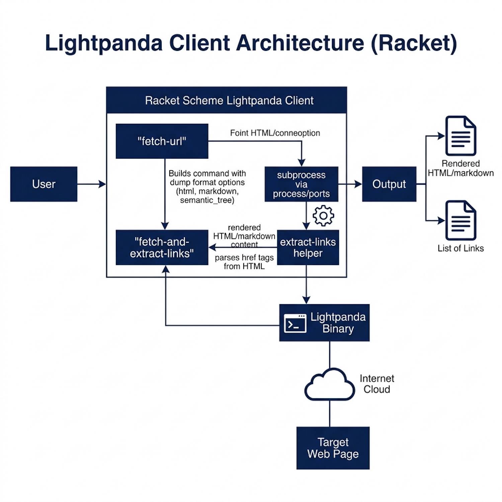

# Interfacing with external programs: A Lightpanda browser client

In this chapter, we build a complete Racket library that interfaces with an external program: the Lightpanda headless web browser. This example demonstrates practical techniques for subprocess management, string processing, and building reusable APIs in Racket. Directions for installing the Lightpanda command line tool can be found in the [Lightpanda documentation](https://lightpanda.io/docs/open-source/installation).

## The problem: JavaScript-rendered web content

Modern web pages often require JavaScript execution to display their content. Traditional HTTP clients like `net/http-easy` (used in the Web Scraping chapter) only fetch static HTML, missing the dynamic content rendered by JavaScript. Lightpanda is a headless browser that runs from the command line and outputs fully rendered pages.

Our goal: create a Racket interface that:
1. Invokes Lightpanda as a subprocess
2. Captures its output (HTML, Markdown, or semantic tree)
3. Provides helper functions for common operations like link extraction

## Project structure

The source code for this chapter is in the directory **Racket-AI-book/source-code/lightpanda**. The project layout follows the standard Racket package convention:

```
lightpanda/
  lightpanda.rkt   — Core implementation
  main.rkt         — Package entry point (re-exports public API)
  README.md        — Usage documentation
```

The **main.rkt** file re-exports the public API from **lightpanda.rkt**, making the library installable as a Racket package with `raco pkg install --scope user`:

```racket
#lang racket/base

(require "lightpanda.rkt")

(provide fetch-url
         fetch-and-extract-links
         demo-fetch
         lightpanda-binary)
```

## Configuration

You must have the `lightpanda` tool installed; here I verify the installation on my laptop:

```
$ which lightpanda
/usr/local/bin/lightpanda
```

We use a Racket **parameter** for configurable settings:

```racket
(define lightpanda-binary (make-parameter "lightpanda"))
```

Racket parameters (created with `make-parameter`) are the idiomatic equivalent of Common Lisp's special variables (`defvar` with earmuffs). They provide thread-safe dynamic binding:

```racket
;; Override the binary path for a specific call:
(parameterize ([lightpanda-binary "/usr/local/bin/lightpanda"])
  (fetch-url "https://example.com/"))

;; Or change it globally:
(lightpanda-binary "/usr/local/bin/lightpanda")
```

## Running external programs with `subprocess`

Racket provides `subprocess` in `racket/system` for launching external processes. Our internal helper locates the executable on the system path and executes it directly using argument lists, ensuring safe argument passing and proper cleanup of resources using `dynamic-wind`:

```racket
(define (run-command exe-path args)
  "Run a command directly, return stdout as a string (or #f on error)."
  (let ([resolved-path (find-executable-path exe-path)])
    (if (not resolved-path)
        (begin
          (eprintf "Executable not found: ~a\n" exe-path)
          #f)
        (with-handlers ([exn:fail?
                         (lambda (e)
                           (eprintf "Command execution error: ~a\n" (exn-message e))
                           #f)])
          (define-values (proc stdout stdin stderr)
            (apply subprocess #f #f #f resolved-path args))
          (dynamic-wind
            (lambda () (close-output-port stdin))
            (lambda ()
              (let ([output (port->string stdout)])
                (subprocess-wait proc)
                (if (zero? (subprocess-status proc))
                    output
                    (begin
                      (eprintf "Command exited with status ~a\n" (subprocess-status proc))
                      #f))))
            (lambda ()
              (close-input-port stdout)
              (close-input-port stderr)))))))
```

Key Racket features used:
- `subprocess`: creates a new process with three pipes (stdout, stdin, stderr) plus the process handle.
- `apply`: calls `subprocess` dynamically with a list of arguments.
- `find-executable-path`: locates the full path of the executable by checking system directories.
- `define-values`: destructures multiple return values from `subprocess` in a single binding.
- `port->string`: reads the entire stdout stream into a Racket string.
- `with-handlers`: gracefully catches exceptions, reporting error details to `stderr` and returning `#f`.
- `dynamic-wind`: guarantees resource cleanup by closing input and output ports regardless of how the evaluation finishes.

## HTML parsing: Extracting links

For link extraction, instead of brittle regular expressions, we use Racket's HTML parsing libraries (`html-parsing` and `xml/path`) to parse HTML into an X-expression and query it:

```racket
(define (extract-links html)
  "Return a list of href strings found in <a> tags within an HTML string."
  (with-handlers ([exn:fail? (lambda (e)
                               (eprintf "Error parsing HTML for links: ~a\n" (exn-message e))
                               '())])
    (define xexp (html->xexp html))
    (se-path*/list '(href) xexp)))
```

Walkthrough:
1. `html->xexp` parses the HTML string into an S-expression representation of HTML (X-expression).
2. `se-path*/list` searches the X-expression and extracts all occurrences of `href` attributes.
3. `with-handlers` catches any parsing failures on malformed HTML, returning an empty list.

The following diagram shows the high-level architecture of the Lightpanda browser client developed in this chapter:

{width: "100%"}


## The main API function

The central function constructs the command line arguments list and invokes the helper:

```racket
(define (fetch-url url
                   #:log-level [log-level "warn"]
                   #:obey-robots [obey-robots #f]
                   #:dump [dump "html"])
  "Fetch URL using `lightpanda fetch`, returning the JS-rendered content string.
DUMP controls what is written to stdout; valid values are:
  \"html\"               - full rendered HTML (default)
  \"markdown\"           - page as Markdown
  \"semantic_tree\"      - semantic tree
  \"semantic_tree_text\" - semantic tree as plain text
No server process is required; lightpanda is invoked directly.

  (fetch-url \"https://markwatson.com/\")
  (fetch-url \"https://markwatson.com/\" #:dump \"markdown\")
"
  (define args
    (append
     (list "fetch")
     (if obey-robots '("--obey_robots") '())
     (list "--dump" dump
           "--log_level" log-level
           "--log_format" "pretty"
           url)))
  (run-command (lightpanda-binary) args))
```

Key techniques:
- `#:keyword [param default]`: Racket's keyword arguments with default values.
- `(if obey-robots '("--obey_robots") '())`: conditional list inclusion.
- `append`: combines several lists into a single flat argument list.
- `(lightpanda-binary)`: invokes the configuration parameter.

## Helper functions

Higher-level helpers make common operations easy:

```racket
(define (fetch-and-extract-links url)
  "Fetch URL with lightpanda and return a list of href link strings.

  (fetch-and-extract-links \"https://markwatson.com/\")
"
  (define html (fetch-url url))
  (if html
      (extract-links html)
      (begin
        (eprintf "Failed to fetch ~a\n" url)
        '())))

(define (demo-fetch url)
  "Fetch URL, print a snippet of HTML and the discovered links.

  (demo-fetch \"https://markwatson.com/\")
"
  (printf "\n=== Fetch demo: ~a ===\n" url)
  (define html (fetch-url url))
  (if html
      (let ([links (extract-links html)])
        (printf "Received ~a bytes of HTML.\n" (string-length html))
        (printf "First 500 chars:\n~a\n\n"
                (substring html 0 (min 500 (string-length html))))
        (printf "Found ~a link(s):\n" (length links))
        (for ([l (in-list links)])
          (printf "  ~a\n" l)))
      (printf "No HTML returned.\n")))
```

Note that `extract-links` is *not* listed in `provide` — Racket's module system makes it private by default. This is cleaner than the Common Lisp `%`-prefix convention: in Racket, privacy is enforced by the language rather than by naming convention.

## Usage examples

After installing with `raco pkg install --scope user` (from the source directory) you can load the library from anywhere with `(require lightpanda)`. Without installing, load it by path, for example `(require "lightpanda.rkt")` from the source directory:

```racket
(require lightpanda)

;; Basic HTML fetch
(fetch-url "https://markwatson.com/")

;; Get Markdown output (good for LLM input)
(fetch-url "https://markwatson.com/" #:dump "markdown")

;; Respect robots.txt
(fetch-url "https://markwatson.com/" #:obey-robots #t)

;; Extract all links
(fetch-and-extract-links "https://markwatson.com/")

;; Interactive demo
(demo-fetch "https://markwatson.com/")
```

You can also run the demo directly from the command line:

```
$ racket lightpanda.rkt

=== Fetch demo: https://markwatson.com/ ===
Received 12847 bytes of HTML.
First 500 chars:
<!DOCTYPE html><html lang="en-us">  <head> ...

Found 14 link(s):
  /index.css
  https://mark-watson.blogspot.com
  ...
```

The directory also contains **tests.rkt**, which runs without the lightpanda program or a network connection. It checks link extraction on a fixed HTML string, and it checks that a missing binary gives `#f` and an empty list of links instead of an exception. Run it with **raco test tests.rkt**.

## Key Racket takeaways

1. `subprocess`: portable subprocess execution; returns four values (process, stdout, stdin, stderr)
2. `make-parameter`: thread-safe dynamic configuration with `parameterize` for scoped overrides
3. `provide` / module system: privacy is enforced by what you export, not by naming conventions
4. Keyword arguments: `#:key [param default]` for flexible, self-documenting APIs
5. Named `let`: tail-recursive loops without mutation: `(let loop ([acc '()] ...) ...)`
6. `with-handlers`: structured exception handling with predicate-based dispatch

This pattern (shelling out to a specialized tool and processing its output) is a powerful technique. You can wrap any command-line tool this way: databases, image processors, compilers, or your own scripts. The result is a Racket API that hides the implementation details while providing access to the tool's capabilities.

## Optional practice problems

1. Verify Binary Installation: implement a function `verify-lightpanda-path` that validates if the configured `lightpanda-binary` path exists using `find-executable-path`. If the binary cannot be resolved, raise a clear user-facing error message with advice on installation.
2. Support Dynamic Fetch Options: extend the `fetch-url` function to support additional command-line parameters that Lightpanda offers (for example, setting a custom `--user_agent` or specifying custom `--headers`).
3. Capture Process Standard Error: in `run-command`, standard error output is discarded. Refactor the subprocess handling to capture `stderr` from the subprocess and include its contents in the error output logs when the exit code is non-zero.
4. Compare With a Plain HTTP Fetch: pick a web page that builds its content with JavaScript. Fetch it with `web-uri->text` from the web scraping chapter and with `(fetch-url url #:dump "markdown")` from this chapter, and compare the amount of readable text each one returns. Then try a mostly static page, where the two should agree, and time both approaches.
