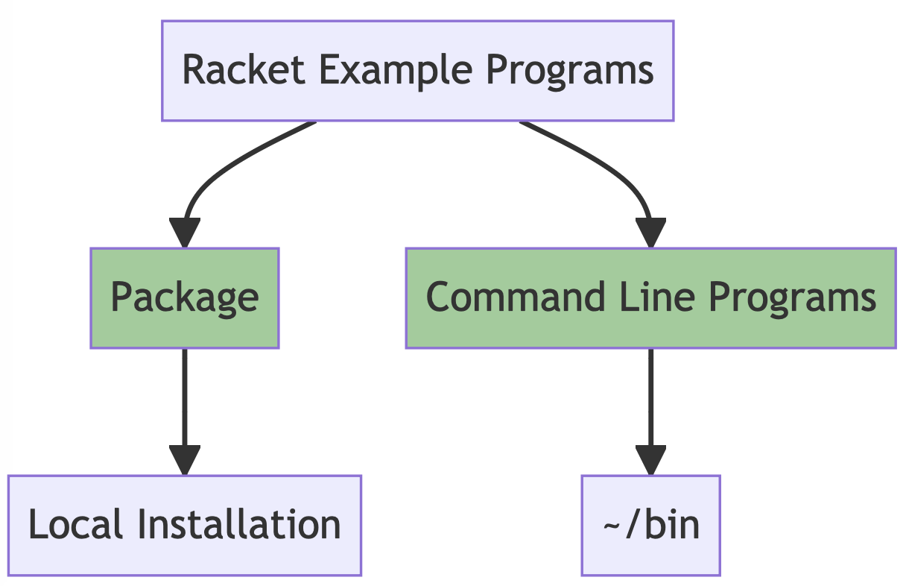

# Preface

Racket is a Lisp language. I have been using Lisp languages since the 1970s.

Dear reader, I love developing code in Lisp languages and my hope is that you will too. Racket is a "batteries included" language that includes a nice IDE, a great *standard library*, and many open source projects in the *Racket universe*.

In 1982 my company bought a Lisp Machine for my use. A Lisp Machine provided an "all batteries included" working environment, but now no one seriously uses Lisp Machines. In this book I try to lead you, dear reader, through a process of creating a "batteries included" working environment using Racket Scheme.

The latest edition is always available for purchase at [https://leanpub.com/racket-ai](https://leanpub.com/racket-ai).  You can also read free online at [https://leanpub.com/racket-ai/read](https://leanpub.com/racket-ai/read). I offer the purchase option for readers who wish to directly support my work.

This is a "live book:" there will never be a second edition. As I add material and make corrections, I simply update the book and the free to read online copy and all eBook formats for purchase get updated.

I have been developing commercial Artificial Intelligence (AI) tools and applications since the 1980s and I usually use the Lisp languages Common Lisp, Clojure, Racket Scheme, and Gambit Scheme. Here you will find Racket code that I wrote for my own use and I am wrapping in a book in the hopes that it will also be useful to you, dear reader.

This book is written for both professional programmers and home hobbyists who already know how to program in Racket (or another Scheme dialect) and who want to learn practical AI programming and information processing techniques. I have tried to make this an enjoyable book to work through. In the style of a "cook book," most chapters can be read in any order. There are three exceptions: the Knowledge Graph Navigator chapter uses the libraries from the datastores and natural language processing chapters, the agentic RAG chapter builds on the embeddings chapter before it, and the Racklog chapter solves the same two problems as the OPS5 chapter before it. 

You can find the code examples and the files for the manuscript for this book in the following GitHub repository:

[https://github.com/mark-watson/Racket-AI-book](https://github.com/mark-watson/Racket-AI-book)

Git pull requests with code improvements for either the source code or manuscript markdown files will be appreciated by me and the readers of this book.

## Requests from the author

This book will always be available to read free online at [https://leanpub.com/racket-ai/read](https://leanpub.com/racket-ai/read).

That said, I appreciate it when readers purchase my books because the income enables me to spend more time writing.

### Hire the author as a consultant

I am available for short consulting projects. Please see [https://markwatson.com](https://markwatson.com).

## License for book manuscript: Creative Commons

Copyright 2022-2026 Mark Watson. All rights reserved.

This book may be shared using the Creative Commons "share and share alike, no modifications, no commercial reuse" license.

## Book example programs

Here are the example projects for this book, in the order the chapters use them:

Part 1, tutorial and datastores:

- misc_code - Short examples for the tutorial chapter: hash tables, HTTP requests, HTML parsing, and SQLite.
- sparql - A small SPARQL client for querying DBpedia.
- simple_RDF_SPARQL - An RDF datastore with partial SPARQL support, written from scratch.

Part 2, web scraping and browser use:

- webscrape - Fetch web pages and extract text, links, and headers.
- lightpanda - A client for the Lightpanda headless browser, for pages that need JavaScript.

Part 3, large language models:

- Karpathy_MicroGPT - A tiny GPT with its own autograd engine, for learning how LLMs work inside.
- llmapis - One uniform API for OpenAI, Google Gemini, Anthropic, Mistral, and local models, plus provider-specific modules.
- racket_llm_language - Short examples using William J. Bowman's **#lang llm**.
- ollama_tools - Tool (function) calling with local models.
- coding-agent-harness - A complete coding agent with tools, an approval step for edits, and web search.
- embeddingsdb - Embeddings stored in SQLite, with retrieval and question answering.
- RAG - Agentic retrieval augmented generation using Gemini.

Part 4, deep learning, NLP, and knowledge graphs:

- Malt_deep_learning - Neural networks using the Malt library.
- deep_learning_category_theory - A small deep learning framework organized around ideas from category theory.
- ReinforcementLearning - Bandits, Q-learning, policy gradients, and DQN.
- nlp - Part-of-speech tagging and finding the names of people and places.
- kgn - The Knowledge Graph Navigator application.

Part 5, rule based systems:

- OPS5_in_Racket - The OPS5 production system language.
- Racklog_expert_systems_logic - The same two problems solved with Prolog-style logic programming.

Part 6, miscellaneous:

- math-pi-e - Fourteen classical algorithms for computing pi and e in exact arithmetic.

The repository also has a few examples that are not covered by a chapter yet (for example **genetic_programming**, **pdf_chat**, and the two web search wrappers). The file **source-code/README.md** lists every directory with the packages and API keys it needs.

All of the example code is released under the Apache 2 license with one exception: the coding agent in **coding-agent-harness** is released under the AGPL version 3 license.

You can check your setup without any API keys. In the **source-code** directory, **make compile** compiles the examples and **make test** runs the test suites that need no network connection.

The following diagram showing Racket software examples configured for your local laptop. There are several combined examples that build both to a Racket package that get installed locally, as well as command line programs that get built and deployed to **~/bin**. Other examples are either a command line tool or a Racket package.

## Racket, Scheme, and Common Lisp

I like Common Lisp slightly more than Racket and other Scheme dialects, even though Common Lisp is ancient and has defects. Then why do I use Racket?
Racket is a family of languages, a very good IDE, and a rich ecosystem supported by many core Racket developers and Racket library authors. Choosing Racket Scheme was an easy decision, but there are also other Scheme dialects that I enjoy using:

- Gambit/C Scheme
- Gerbil Scheme (based on Gambit/C)
- Chez Scheme

## Personal Artificial Intelligence journey: Or, life as a Lisp developer

I have been interested in AI since reading Bertram Raphael's excellent book *Thinking Computer: Mind Inside Matter* in the early 1980s. I have also had the good fortune to work on many interesting AI projects including the development of commercial expert system tools for the Xerox LISP machines and the Apple Macintosh, development of commercial neural network tools, application of natural language and expert systems technology, medical information systems, application of AI technologies to Nintendo and PC video games, and the application of AI technologies to the financial markets. I have also applied statistical natural language processing techniques to analyzing social media data from Twitter and Facebook. I worked at Google on their Knowledge Graph and I managed a deep learning team at Capital One where I was awarded 55 US patents.

I enjoy AI programming, and hopefully this enthusiasm will also infect you.

## Acknowledgements

I produced the manuscript for this book using the [leanpub.com](http://leanpub.com) publishing system and I recommend leanpub.com to other authors.

**Editor: Carol Watson**

Thanks to the following people who found typos in this and earlier book editions: David Rupp.
