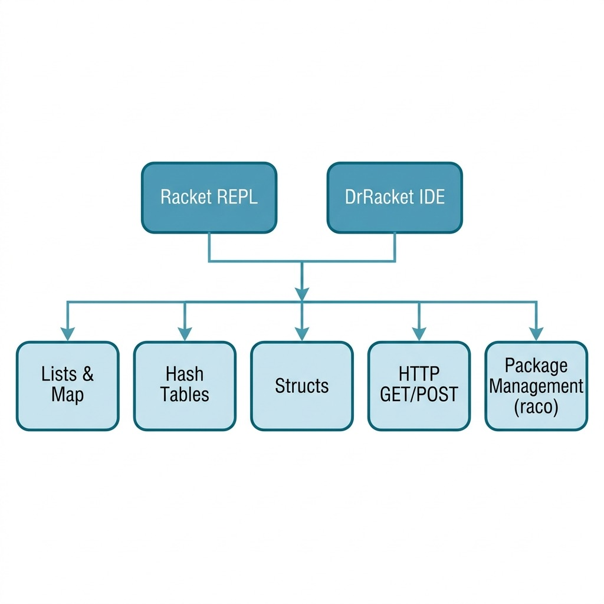

# A quick Racket tutorial

If you are an experienced Racket developer then feel free to skip this chapter! I wrote this tutorial to cover just the aspects of using Racket that you, dear reader, will need to understand, modify, and generally reuse the example programs in this book.

I assume that you have read the section **Racket Essentials** in the [The Racket Guide](https://docs.racket-lang.org/guide/) written by Matthew Flatt, Robert Bruce Findler, and the PLT group. Here I just cover some basics of getting started so you can enjoy the later code examples without encountering "road blocks."

## Installing packages

The DrRacket IDE lets you interactively install packages. I prefer using the command line so, for example, I would install the two packages that most examples in this book use for HTTP requests and for parsing HTML with:

    raco pkg install --auto http-easy html-parsing

The **--auto** flag also installs any packages that these two depend on. We can then require the code in these packages in our Racket programs:

```racket
(require net/http-easy)
(require html-parsing)
```

Some libraries, like the **db** library that we use later for SQLite, are part of the standard Racket distribution and need no install step.

Note that when the argument to **require** is a symbol (not a string) then modules are searched and loaded from your system. When the argument is a string like "utils.rkt" then a module is loaded from a file, relative to the file that contains the **require**. The examples in this book use this second form to load each other, for example **(require "../llmapis/llmapis.rkt")**, so you can run them without installing anything as a package.

## Installing local packages in place

In a later chapter **Natural Language Processing (NLP)** we define a fairly complicated local package. This package has one unusual requirement that you may or may not need in your own projects: My NLP library requires static linguistic data files that are stored in the directory **Racket-AI-book/source-code/nlp/data**. If I am in the directory **Racket-AI-book/source-code/nlp** working on the Racket code, it is simple enough to just open the files in **./data/...**.

The default for installing your own Racket packages is to link to the original source directory on your laptop's file system. Let's walk through this. First, I will make sure my library code is compiled and then install the code in the current directory:

```bash
cd Racket-AI-book/source-code/nlp/
raco make *.rkt
raco pkg install --scope user
```

Then I can run the **racket** REPL (or DrRacket) on my laptop and use my NLP package by requiring the code in this package in our Racket programs (shown in a REPL):

```racket
> (require nlp)
loading lex-hash......done.
> (parts-of-speech (list->vector '("the" "cat" "ran")))
'#("DT" "NN" "VBD")
> (find-place-names
    '#("George" "Bush" "went" "to" "San" "Diego"
       "and" "London") '())
'("London" "San Diego")
> (find-human-names
    '#("who" "is" "Bill" "Gates") '())
'("Bill Gates")
> 
```


## Mapping over lists

We will be using functions that take other functions as arguments. Here we define a function **1+** that has one function argument **n** and returns **n + 1** as the value for a function call:

```racket
> (range 5)
'(0 1 2 3 4)
> (define (1+ n) (+ n 1))
> (map 1+ (range 5))
'(1 2 3 4 5)
> (map + (range 5) '(100 101 102 103 104))
'(100 102 104 106 108)
> 
```

Does the evaluation of the last expression confuse you? Let's take a closer look:

- The function **map** is a higher-order function that takes a procedure (in this case, +) and one or more lists as arguments. It applies the procedure to the corresponding elements of the lists and returns a new list containing the results.
- First list argument: (range 5) is evaluated first. The range function generates a sequence of numbers starting from 0 up to (but not including) the given number. So, (range 5) produces the list '(0 1 2 3 4).
- Second list argument: '(100 101 102 103 104) is a quoted list, meaning it is treated as data and evaluates to itself.
- Element-wise Application: map then applies the + function to the elements of the two lists in a pairwise fashion:
- (+ 0 100) evaluates to 100
- (+ 1 101) evaluates to 102
- (+ 2 102) evaluates to 104
- (+ 3 103) evaluates to 106
- (+ 4 104) evaluates to 108
- Final Result: The results of each addition are collected into a new list, producing the final output: '(100 102 104 106 108).


## Hash tables

The following listing shows the file **misc_code/hash_tests.rkt**:

```racket
#lang racket

(define h1 (hash "dog" '("friendly" 5) "cat" '("not friendly" 2))) ;; not mutable

(define cat (hash-ref h1 "cat"))

(define h2 (make-hash)) ;; mutable
(hash-set! h2 "snake" '("smooth" 4))

;; make-hash also accepts an argument that is a list of key/value pairs
;; (a pair is written with a dot: (key . value))
(define h3 (make-hash '(("dog" . ("friendly" 5)) ("cat" . ("not friendly" 2)))))
(hash-set! h3 "snake" '("smooth" 4))
(hash-set! h3 "cat" '("sometimes likeable" 3)) ;; overwrite key value

;; for can be used with hash tables:

(for ([(k v) h3]) (println (list "key:" k "value:" v)))
```

This Racket code demonstrates the creation and manipulation of hash tables which are data structures that map keys to values. It first shows an immutable hash table **h1**, created with built-in function **hash**, where values are retrieved using **hash-ref**. It then introduces mutable hash tables **h2** and **h3** we created with **make-hash**, which can be modified after creation using the built-in function **hash-set!**. The function **hash-set!** can either add a new key-value pair or overwrite the value of an existing key. Finally, the code uses a **for** loop to iterate through the key-value pairs of a mutable hash table, printing each one to the console, illustrating a common way to process all entries in the collection.

Here is a listing of the output window after running this file and then manually evaluating *h1*, *h2*, and *h3* in the REPL (like all listings in this book, I manually edit the output to fit page width):

```
Welcome to DrRacket, version 9.3 [cs].
Language: racket, with debugging; memory limit: 128 MB.
'("key:" "snake" "value:" ("smooth" 4))
'("key:" "cat" "value:" ("sometimes likeable" 3))
'("key:" "dog" "value:" ("friendly" 5))
> h1
'#hash(("cat" . ("not friendly" 2)) ("dog" . ("friendly" 5)))
> h2
'#hash(("snake" . ("smooth" 4)))
> h3
'#hash(("cat" . ("sometimes likeable" 3))
       ("dog" . ("friendly" 5))
       ("snake" . ("smooth" 4)))
> 
```

Notice that the **for** loop uses **(list "key:" k "value:" v)** and not a quoted list. Quoting a list, as in **'("key:" k "value:" v)**, turns everything inside it into literal data, so **k** and **v** would print as the symbols k and v instead of their values. Notice also that the order in which a hash table is traversed is not the order in which keys were added.

## Racket structure types

A structure type is a fixed set of named fields. Defining one makes Racket write the accessors, the mutators, and a constructor named after the structure. Here is a small example with mutable fields:

```racket
> (struct person (name age email) #:mutable)
> (define henry (person "Henry Higgans" 45 "henry@higgans.com"))
> (person-age henry)
45
> (set-person-age! henry 46)
> (person-age henry)
46
> (set-person-email! henry "henryh674373551@gmail.com")
> (person-email henry)
"henryh674373551@gmail.com"
> 
```

If you don't add **#:mutable** to a **struct** definition, then no **set-NAME-ATTRIBUTE!** methods are generated. For mutable or immutable **struct** definitions, accessor functions like **person-age** and **person-email** are written for you from a **struct** definition and take the form **NAME-OF-STRUCT**-**FIELD-NAME**.

Racket also supports object oriented programming style classes with methods. I don't use classes in the book examples so you, dear reader, can read the official Racket [documentation on classes](https://docs.racket-lang.org/guide/classes.html) if you want to use Racket in a non-functional way.


## Simple HTTP GET and POST operations 

We will be using HTTP GET and POST instructions in later chapters for web scraping and accessing remote APIs, such as those for OpenAI, Google Gemini, and local models. We will see more detail later but for now, you can try a simple example:

```racket
#lang racket

(require net/http-easy)
(require html-parsing)
(require net/url xml xml/path)
(require racket/pretty)

(define res-stream
  (get "https://markwatson.com" #:stream? #t))

(define lst
  (html->xexp (response-output res-stream)))

(response-close! res-stream)

(displayln "\nParagraph text:\n")

(pretty-print (take (se-path*/list '(p) lst) 8))

(displayln "\nLI text:\n")

(pretty-print (take (se-path*/list '(li) lst) 8))
```

This Racket script is a web scraper that fetches the HTML content from markwatson.com. It then parses the raw HTML into a structured S-expression format, which is a data representation native to Lisp-like languages. Using this structured data, the script queries for all paragraph (<p>) and list item (<li>) tags. Finally, it uses pretty-print to display the first eight instances of each tag type it finds, effectively extracting and showing specific content from the web page.

The output is (with most of the output removed for brevity):

```

Paragraph text:

'("My customer list includes: Google, Capital One, Babylist, Olive AI, CompassLabs, Mind AI, Disney, SAIC, Americast, PacBell, CastTV, Lutris Technology, Arctan Group, Sitescout.com, Embed.ly, and Webmind Corporation."
  "I have worked in the fields of general\n"
  "      artificial intelligence, machine learning, semantic web and linked data, and\n"
  "      natural language processing since 1982."
  "My eBooks are available to read for FREE or you can purchase them at "
  (a (@ (href "https://leanpub.com/u/markwatson")) "leanpub")
  "."
  "My standard ")

LI text:

'((@ (class "list f4 f3-ns fw4 dib pr3"))
  "\n"
  "            "
  (& nbsp)
  (& nbsp)
  (a
   (@
    (class "hover-white no-underline white-90")
    (href "https://mark-watson.blogspot.com")
    (target "new")
    (title "Mark's Blog on Blogspot"))
   "\n"
   "              Read my Blog\n"
   "            ")
  "\n"
  "          ")
```

## More Racket that you will see in this book

The later chapters lean on a handful of Racket features that the examples so far have not shown. Each one gets a short example here so that you will recognize it when you see it.

### Optional and keyword arguments

A function argument written in square brackets is optional and has a default value. An argument introduced with a keyword like **#:greeting** is passed by name, in any position:

```racket
> (define (greet name #:greeting [greeting "Hello"] [punctuation "!"])
    (string-append greeting ", " name punctuation))
> (greet "Ana")
"Hello, Ana!"
> (greet "Ana" #:greeting "Hi")
"Hi, Ana!"
> (greet "Ana" "?" #:greeting "Hi")
"Hi, Ana?"
```

Most of the LLM functions in this book take keyword arguments for things like the maximum number of tokens to generate.

### Parameters

A parameter is a setting that you can change for the duration of one block of code. Calling a parameter with no arguments reads its value, and **parameterize** temporarily gives it a new value:

```racket
> (define current-model (make-parameter "small-model"))
> (define (describe) (format "using ~a" (current-model)))
> (describe)
"using small-model"
> (parameterize ([current-model "large-model"])
    (describe))
"using large-model"
> (describe)
"using small-model"
```

The examples use parameters for settings like model names and database file names. The tests use **parameterize** to replace a function that calls a remote API with a stand-in that needs no network.

### Handling errors with with-handlers

**with-handlers** pairs a test for a kind of exception with a function that handles it. The predicate **exn:fail?** matches almost every error:

```racket
> (define (safe-divide a b)
    (with-handlers ([exn:fail:contract:divide-by-zero?
                     (lambda (e) 'undefined)])
      (/ a b)))
> (safe-divide 10 4)
5/2
> (safe-divide 10 0)
'undefined
> (with-handlers ([exn:fail? (lambda (e) (exn-message e))])
    (error 'fetch "status ~a" 404))
"fetch: status 404"
```

Notice that dividing two integers gives the exact fraction 5/2. Racket only switches to floating point when one of the numbers is already floating point. The chapter on computing pi and e relies on this.

### Pattern matching with match

**match** compares a value against patterns in order and binds the variables in the first pattern that fits. An underscore matches anything:

```racket
> (define (describe-reply reply)
    (match reply
      [(list 'ok text) (string-append "answer: " text)]
      [(list 'error code _) #:when (>= code 500)
       "server problem, try again"]
      [(list 'error code message)
       (format "error ~a: ~a" code message)]
      [_ "unrecognized reply"]))
> (describe-reply '(ok "42"))
"answer: 42"
> (describe-reply '(error 503 "busy"))
"server problem, try again"
> (describe-reply '(error 401 "bad key"))
"error 401: bad key"
```

### The for family of loops

We already used **for** with a hash table. The variations collect results in different ways, and you can iterate over several sequences in step:

```racket
> (for/list ([x '(1 2 3)]) (* x x))
'(1 4 9)
> (for/list ([x '(1 2 3 4 5 6)] #:when (even? x)) x)
'(2 4 6)
> (for/sum ([x '(1 2 3)] [y '(10 20 30)]) (* x y))
140
> (for/hash ([word '("a" "bb" "ccc")])
    (values word (string-length word)))
'#hash(("a" . 1) ("bb" . 2) ("ccc" . 3))
> (for ([word '("a" "bb")] [i (in-naturals)])
    (printf "~a: ~a\n" i word))
0: a
1: bb
```

### JSON data is hash tables and lists

Every LLM API in this book sends and receives JSON. The **json** library reads a JSON object as a hash table with symbols for keys and a JSON array as a list:

```racket
> (require json)
> (define reply
    (string->jsexpr
     "{\"model\": \"m1\", \"choices\": [{\"text\": \"hi\"}]}"))
> reply
'#hasheq((choices . (#hasheq((text . "hi")))) (model . "m1"))
> (hash-ref reply 'model)
"m1"
> (hash-ref (first (hash-ref reply 'choices)) 'text)
"hi"
> (hash-ref reply 'missing "a default")
"a default"
> (jsexpr->string (hash 'prompt "hello" 'max_tokens 20))
"{\"max_tokens\":20,\"prompt\":\"hello\"}"
```

The third argument to **hash-ref** is a default to return when the key is missing. Without it a missing key raises an error.

### Submodules: main and test

Many example files end with a **(module+ main ...)** form. The code inside it runs when you run the file with **racket file.rkt** but not when another file requires it, so one file can be both a library and a program. In the same way, the code in a **(module+ test ...)** form runs only under **raco test file.rkt**:

```racket
#lang racket

(provide double)

(define (double x) (* 2 x))

(module+ main
  (displayln (double 21)))

(module+ test
  (require rackunit)
  (check-equal? (double 21) 42))
```

Most example directories have a **tests.rkt** file. Running **make test** in the **source-code** directory runs all of them, and none of them needs an API key or a network connection.

### Finding data files with define-runtime-path

A relative file name like "data/names.txt" is looked up from the directory you happen to run **racket** in. A library that reads its own data files uses **define-runtime-path** instead, which resolves the path relative to the source file:

```racket
(require racket/runtime-path)
(define-runtime-path data-dir "data")
(file->lines (build-path data-dir "names.txt"))
```

The NLP library uses this to find its word lists no matter where it is called from.

## Using Racket ~/.racketrc initialization file

In my Racket workflow I don't usually use **~/.racketrc** to define initial forms that are automatically loaded when starting the **racket** command line tool or the **DrRacket** application. That said I do like to use **~/.racketrc** for temporary initialization forms when working on a specific project to increase the velocity of interactive development.

Here is an example use:

```console
$ cat ~/.racketrc
(define (foo-list x)
  (list x x x))
$ racket
Welcome to Racket v9.3 [cs].
> (foo-list 3.14159)
'(3.14159 3.14159 3.14159)
> 
```

If you have local and public libraries you frequently load you can permanently keep **require** forms for them in **~/.racketrc** but that will slightly slow down the startup times of **racket** and **DrRacket**.

The following diagram shows the key Racket concepts and tools covered in this tutorial chapter:

{width: "100%"}


## Tutorial wrap up

The rest of this book is comprised of example Racket programs that I have written for my own enjoyment that I hope will also be useful to you, dear reader. Please refer to the [The Racket Guide](https://docs.racket-lang.org/guide/) for more technical detail on effectively using the Racket language and ecosystem.

## Optional practice problems

1. **Count words with a hash table**: Write a function that takes a string, splits it into words with **string-split**, and returns a hash table mapping each word to the number of times it appears. Use **for/fold** or a mutable hash table with **hash-update!**.
2. **A parameter for verbosity**: Define a parameter **verbose?** with a default of **#f** and a function **log-message** that prints its argument only when **verbose?** is true. Check that **parameterize** turns the output on for one call only.
3. **Read a JSON reply safely**: Write a function that takes a JSON string and returns the value at the path **choices**, first element, **text**, or **#f** if the string is not valid JSON or any step of the path is missing. Use **with-handlers** and the default argument of **hash-ref**.
