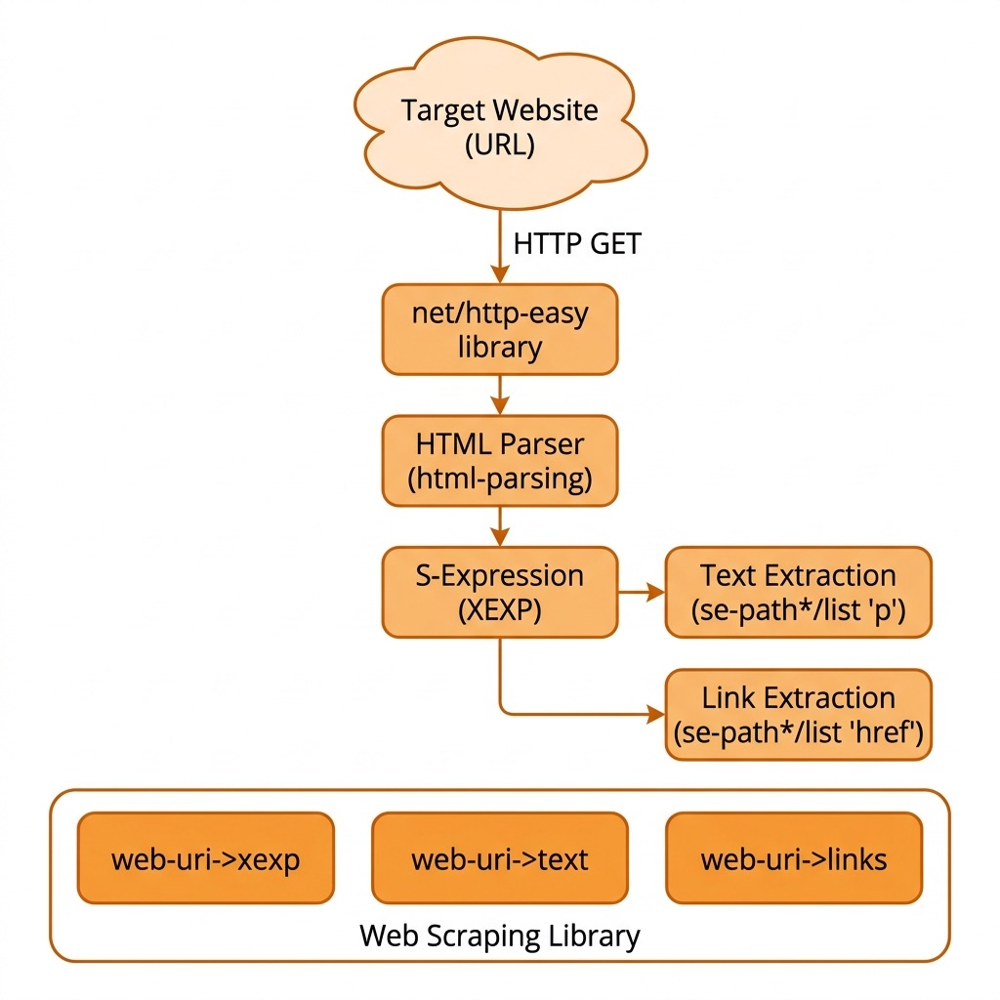

# Web scraping

I often write software to automatically collect and use data from the web and other sources. As a practical matter, much of the data that many people use for machine learning comes from either the web or from internal data sources. This section provides some guidance and examples for getting text data from the web.

Before we start a technical discussion about web scraping I want to point out that much of the information on the web is copyright, so first you should read the terms of service for web sites to insure that your use of "scraped" or "spidered" data conforms with the wishes of the persons or organizations who own the content and pay to run scraped web sites.

We start with low-level Racket code examples in the GitHub repository for this book in the directory **Racket-AI-book/source-code/misc_code**. We will then implement a standalone library in the directory **Racket-AI-book/source-code/webscrape**.

## Getting started web scraping

All of the examples in the section can be found in the Racket code snippet files in the directory **Racket-AI-book/source-code/misc_code**.

I have edited the output for brevity in the following REPL output:

```racket
$ racket
Welcome to Racket v8.10 [cs].
> (require net/http-easy)
> (require html-parsing)
> (require net/url xml xml/path)
> (require racket/pretty)
> (define res-stream
    (get "https://markwatson.com" #:stream? #t))
> res-stream
#<response>
> (define lst
    (html->xexp (response-output res-stream)))
> lst
'(*TOP*
  (*DECL* DOCTYPE html)
  "\n"
  (html
   (@ (lang "en-us"))
   "\n"
   "  "
   (head
    (title
     "Mark Watson: AI Practitioner and Author of 20+ AI Books | Mark Watson")
  ...
```

Different element types are **html**, **head**, **p**, **h1**, **h2**, etc. If you are familiar with XPATH operations for XML data, then the function **se-path\*/list** will make more sense to you. The function **se-path\*/list** takes a list of element types from a list and recursively searches an input s-expression for lists starting with one of the target element types. In the following example we extract all elements of type **p**:

```racket
> (se-path*/list '(p) lst) ;; get text from all p elements
'("My customer list includes: Google, Capital One, Babylist, Olive AI, CompassLabs, Mind AI, Disney, SAIC, Americast, PacBell, CastTV, Lutris Technology, Arctan Group, Sitescout.com, Embed.ly, and Webmind Corporation."
  "I have worked in the fields of general\n"
  "   artificial intelligence, machine learning, semantic web and linked data, and\n"
  "      natural language processing since 1982."
  "My eBooks are available to read for FREE or you can   purchase them at "
  (a (@ (href "https://leanpub.com/u/markwatson")) "leanpub")
  ...
```


```racket
> (define lst-p (se-path*/list '(p) lst))
> (filter (lambda (s) (string? s)) lst-p) ;; keep only text strings
'("My customer list includes: Google, Capital One, Babylist, Olive AI, CompassLabs, Mind AI, Disney, SAIC, Americast, PacBell, CastTV, Lutris Technology, Arctan Group, Sitescout.com, Embed.ly, and Webmind Corporation."
```


The strings still contain the line breaks and runs of spaces from the HTML source, so we join them and clean up the white space:

```racket
> (string-normalize-spaces
   (string-join
    (filter (lambda (s) (string? s)) lst-p)
    "\n"))
"My customer list includes: Google, Capital One, Babylist, Olive AI, CompassLabs, Mind AI, Disney, SAIC, Americast, PacBell, CastTV, Lutris Technology, Arctan Group, Sitescout.com, Embed.ly, and Webmind Corporation. I have worked in the fields of general artificial intelligence, machine learning, semantic web and linked data, and natural language processing since 1982.
  ...
"
```

Extracting the anchor links takes one call:

```racket
> (se-path*/list '(href) lst) ;; get all links from HTML as a list
'("/index.css"
  "https://mark-watson.blogspot.com"
  "#fun"
  "#books"
  "#opensource"
  "https://markwatson.com/privacy.html"
  "https://leanpub.com/u/markwatson"
  "/nda.txt"
  "https://mastodon.social/@mark_watson"
  "https://twitter.com/mark_l_watson"
  "https://github.com/mark-watson"
  "https://www.linkedin.com/in/marklwatson/"
  "https://markwatson.com/index.rdf"
  "https://www.wikidata.org/wiki/Q18670263"
 ...
)
```

## Implementation of a Racket web scraping library

The web scraping library listed below can be found in the directory **Racket-AI-book/source-code/webscrape**. The following listing of **webscrape.rkt** should look familiar after reading the code snippets in the last section.

The library has two layers. The functions whose names start with **xexp->** work on a page that has already been parsed, so they can be used on HTML from any source and tested without a network connection. The functions whose names start with **web-uri->** fetch a page first and then call the matching **xexp->** function.

- **web-uri->xexp** fetches a URI with the **get** function from **net/http-easy** and parses the HTML into an S-expression (an *xexp*) with **html->xexp** from the **html-parsing** library. It uses a connection timeout and a request timeout, and it raises an error for any HTTP status other than a 2xx success code, so a "404 not found" page is never mistaken for real content.
- **html-string->xexp** parses HTML that you already have in a string.
- **xexp->text** uses **se-path\*/list** from the **xml/path** library to collect the contents of all paragraph (**p**) elements, keeps only the strings (dropping nested tags), joins them, and cleans up white space with **string-normalize-spaces**.
- **xexp->links** collects all **href** attribute values. Called with just a page it returns only absolute links, those starting with "http". Called with the page's own URI as a second argument it also resolves relative links such as "/about.html" into absolute URLs using **combine-url/relative**, and skips links that are not web pages (in-page anchors, **mailto:**, and **javascript:** links).
- **xexp->html-headers** returns three lists with the text of the **h1**, **h2**, and **h3** headers.
- **web-uri->text**, **web-uri->links**, and **web-uri->html-headers** fetch a page and apply the function above. **web-uri->links** takes the keyword argument **#:resolve-relative? #t** to include relative links.

```racket
#lang racket

;;; webscrape.rkt — Web scraping utilities for Racket
;;; Copyright (C) 2022-2026 Mark Watson
;;; Apache 2 License
;;;
;;; The library is split into two layers:
;;;   - pure functions that work on an already-parsed page (an xexp),
;;;     which can be tested without a network connection, and
;;;   - web-uri->... convenience functions that fetch a page first.

(require net/http-easy)
(require html-parsing)
(require net/url xml xml/path)

(provide web-uri->xexp
         web-uri->text
         web-uri->links
         web-uri->html-headers
         html-string->xexp
         xexp->text
         xexp->links
         xexp->html-headers)

; Parse a string of HTML into an XExp structure
(define (html-string->xexp html)
  (html->xexp html))

; Fetch a web page and return its HTML as an XExp structure.
; A-URI is a URL string or bytes. Raises exn:fail:network on connection
; problems and exn:fail on any HTTP status other than 2xx.
(define (web-uri->xexp a-uri)
  (define resp
    (get a-uri
         #:stream? #t
         #:timeouts (make-timeout-config #:connect 10 #:request 30)))
  (define status (response-status-code resp))
  (cond
    [(<= 200 status 299)
     (define xexp (html->xexp (response-output resp)))
     (response-close! resp)
     xexp]
    [else
     (response-close! resp)
     (error 'web-uri->xexp "HTTP status ~a fetching ~a" status a-uri)]))

; Extract all paragraph text from a parsed page
(define (xexp->text a-xexp)
  (define p-elements (se-path*/list '(p) a-xexp))
  ; Keep only strings (text content) and normalize whitespace
  (define text-strings
    (for/list ([elem p-elements]
               #:when (string? elem))
      elem))
  (string-normalize-spaces
   (string-join text-strings "\n")))

; Extract links from a parsed page.
; With no BASE-URI only absolute links (starting with http) are returned.
; With a BASE-URI string, relative links such as "/about.html" are
; resolved against it and returned as absolute URLs too.
(define (xexp->links a-xexp [base-uri #f])
  (define all-hrefs
    (filter string? (se-path*/list '(href) a-xexp)))
  (define (absolute? href) (string-prefix? href "http"))
  (cond
    [base-uri
     (define base (string->url base-uri))
     (for/list ([href all-hrefs]
                #:unless (or (string-prefix? href "#")
                             (string-prefix? href "mailto:")
                             (string-prefix? href "javascript:")))
       (if (absolute? href)
           href
           (url->string (combine-url/relative base href))))]
    [else (filter absolute? all-hrefs)]))

; Extract HTML headers (H1, H2, H3) from a parsed page.
; Returns a list of lists: (list (h1-headers...) (h2-headers...) (h3-headers...))
(define (xexp->html-headers a-xexp)
  (for/list ([tag '(h1 h2 h3)])
    (for/list ([h (se-path*/list (list tag) a-xexp)]
               #:when (string? h))
      h)))

; Fetch a page and extract all paragraph text
(define (web-uri->text a-uri)
  (xexp->text (web-uri->xexp a-uri)))

; Fetch a page and extract all external links (starting with http).
; Pass #:resolve-relative? #t to also get relative links as absolute URLs.
(define (web-uri->links a-uri #:resolve-relative? [resolve-relative? #f])
  (xexp->links (web-uri->xexp a-uri)
               (and resolve-relative?
                    (if (bytes? a-uri) (bytes->string/utf-8 a-uri) a-uri))))

; Fetch a page and extract H1, H2, and H3 headers
(define (web-uri->html-headers a-uri)
  (xexp->html-headers (web-uri->xexp a-uri)))

(module+ main
  ; (web-uri->xexp "https://knowledgebooks.com")
  ; (web-uri->text "https://knowledgebooks.com")
  ; (web-uri->links "https://knowledgebooks.com")
  (void))
```

Here are a few examples in a Racket REPL (most output omitted for brevity):

```racket
> (web-uri->xexp "https://knowledgebooks.com")
'(*TOP*
  (*DECL* DOCTYPE html)
  "\n"
  (html
   "\n"
   "\n"
   (head
    "\n"
    "    "
    (title "KnowledgeBooks.com - research on the Knowledge Management, and the Semantic Web ")
    "\n"
 ...

> (web-uri->text "https://knowledgebooks.com")
"With the experience of working on Machine Learning and Knowledge Graph applications
 ...

> (web-uri->links "https://knowledgebooks.com")
'("http://markwatson.com"
  "https://oceanprotocol.com/"
  "https://commoncrawl.org/"
  "http://markwatson.com/consulting/"
  "http://kbsportal.com")

> (web-uri->html-headers "https://markwatson.com")
'((...) (... ...) ...) ; returns list of H1, H2, H3 header text lists
```

The functions that work on an already parsed page need no network, which makes them easy to experiment with:

```racket
> (define page
    (html-string->xexp
     "<h1>Title</h1><p>Some text.</p><a href=\"/about.html\">About</a>"))
> (xexp->text page)
"Some text."
> (xexp->links page)
'()
> (xexp->links page "https://example.com/blog/")
'("https://example.com/about.html")
> (xexp->html-headers page)
'(("Title") () ())
```

The file **tests.rkt** in the same directory tests the library this way, against a fixed HTML string. Run it with **raco test tests.rkt**.

The following diagram shows the high-level architecture of the web scraping library developed in this chapter:

{width: "100%"}


If you want to install this library on your laptop using linking (requiring the library access a link to the source code in the directory **Racket-AI-book/source-code/webscrape**) run the following in the library source directory **Racket-AI-book/source-code/webscrape**:

    raco pkg install --scope user

## Being a good citizen

In addition to respecting copyright and terms of service, please keep two things in mind when you fetch more than a page or two from a site. First, most sites publish a **robots.txt** file (for example **https://example.com/robots.txt**) that says which paths automated clients should stay away from, and you should honor it. Second, pause between requests, for example with **(sleep 1)**, so that your program does not put a noticeable load on someone else's server.

The library in this chapter only sees the HTML that a server sends. Many modern pages build their content with JavaScript after the page loads, and for those pages **web-uri->text** returns little or nothing. The next chapter handles that case by driving a headless browser.

## Optional practice problems

1. **Extract full page text**: The `xexp->text` function only retrieves text nested directly within `<p>` tags. Extend it to also extract text from headers (`<h1>` to `<h6>`), list items (`<li>`), and text inside nested tags such as links within a paragraph, to get a more complete textual representation of the page.
2. **Check robots.txt**: Write a function `allowed-by-robots?` that fetches a site's `robots.txt`, finds the `Disallow` lines that apply to all user agents, and returns `#f` when a given URI's path starts with one of them.
3. **A polite crawler**: Using `web-uri->links` with `#:resolve-relative? #t`, write a function that starts at one URI and visits pages on the same host up to a maximum count, sleeping one second between requests and using `with-handlers` so that one failed page does not stop the crawl.
