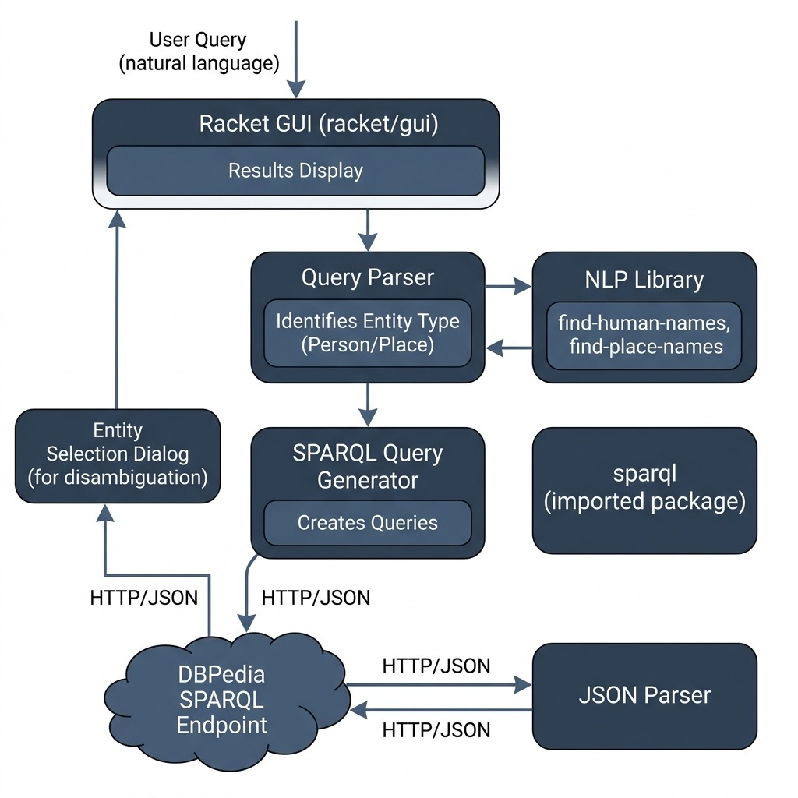

# Knowledge Graph Navigator

**Book Chapter:** [Knowledge Graph Navigator](https://leanpub.com/racket-ai/read) — *Practical Artificial Intelligence Development With Racket* (free to read online).

This project is a port of Mark Watson's Knowledge Graph Navigator to Racket. It demonstrates how to query and navigate knowledge graphs using SPARQL and natural language to extract information.

## Architecture

Test queries:
- "who is Bill Gates?"
- "where is California?"

Only "who is ..." (people) and "where is ..." (places) questions are handled.

The NLP library (`../nlp`) and the SPARQL client (`../sparql`) are loaded by relative path, so there is nothing to install first.

## Creating a standalone application

- Run the default Makefile target to run DrRacket with the local source files.
- Use the menu item `Racket` / `Create Executable`. When building an executable on macOS, choose `GRacket`, not `Racket`, to get a `*.app` bundle.

## Run

    racket kgn.rkt          # the GUI application
    raco test tests.rkt     # offline tests for query parsing

## License and Copyright

This example is released using the Apache 2 license.
Copyright 2022-2025 Mark Watson. All rights reserved.
