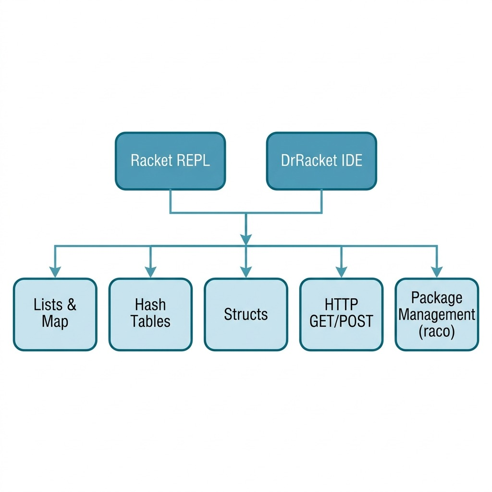

# Miscellaneous Utility Code

**Book Chapter:** [A Quick Racket Tutorial](https://leanpub.com/racket-ai/read) — *Practical Artificial Intelligence Development With Racket* (free to read online).

This directory contains assorted utilities and helper code referenced in the book, covering topics like SQLite integration, list manipulations, hashing, and fetching HTTP content in Racket.

## Architecture

## Install dependencies

The SQLite example uses Racket's built-in `db` library, so there is no Racket package to install.
Make sure the SQLite native library is installed on your OS.

The web examples need two packages:

    raco pkg install --auto http-easy html-parsing

## Run Tests

    racket hash_tests.rkt
    racket sqlite.rkt

## License and Copyright

This example is released using the Apache 2 license.
Copyright 2022-2025 Mark Watson. All rights reserved.
