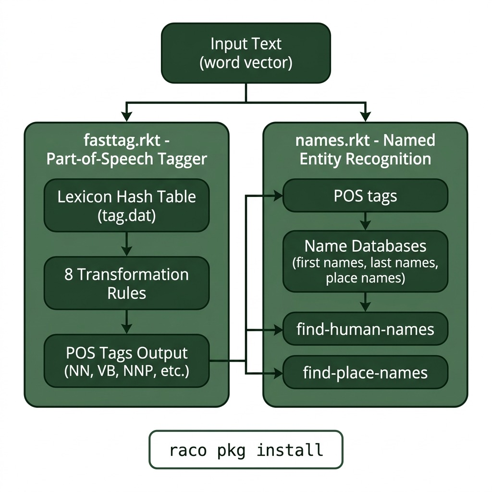

# Natural Language Processing in Racket

**Book Chapter:** [Natural Language Processing](https://leanpub.com/racket-ai/read) — *Practical Artificial Intelligence Development With Racket* (free to read online).

This project implements various NLP utilities in Racket, including Part-Of-Speech (POS) tagging and named entity recognition. It demonstrates foundational text processing techniques essential for AI applications.

## Architecture

## Use from another program

Other examples in this repository load the library with a relative path, which needs no install step:

    (require "../nlp/main.rkt")

You can also install it as a linked local package and then `(require nlp)` from anywhere:

    raco pkg install --scope user

## Run

    racket main.rkt
    raco test tests.rkt     # offline tests for the tagger and name finders

## License and Copyright

This example is released using the Apache 2 license.
Copyright 2022-2025 Mark Watson. All rights reserved.
