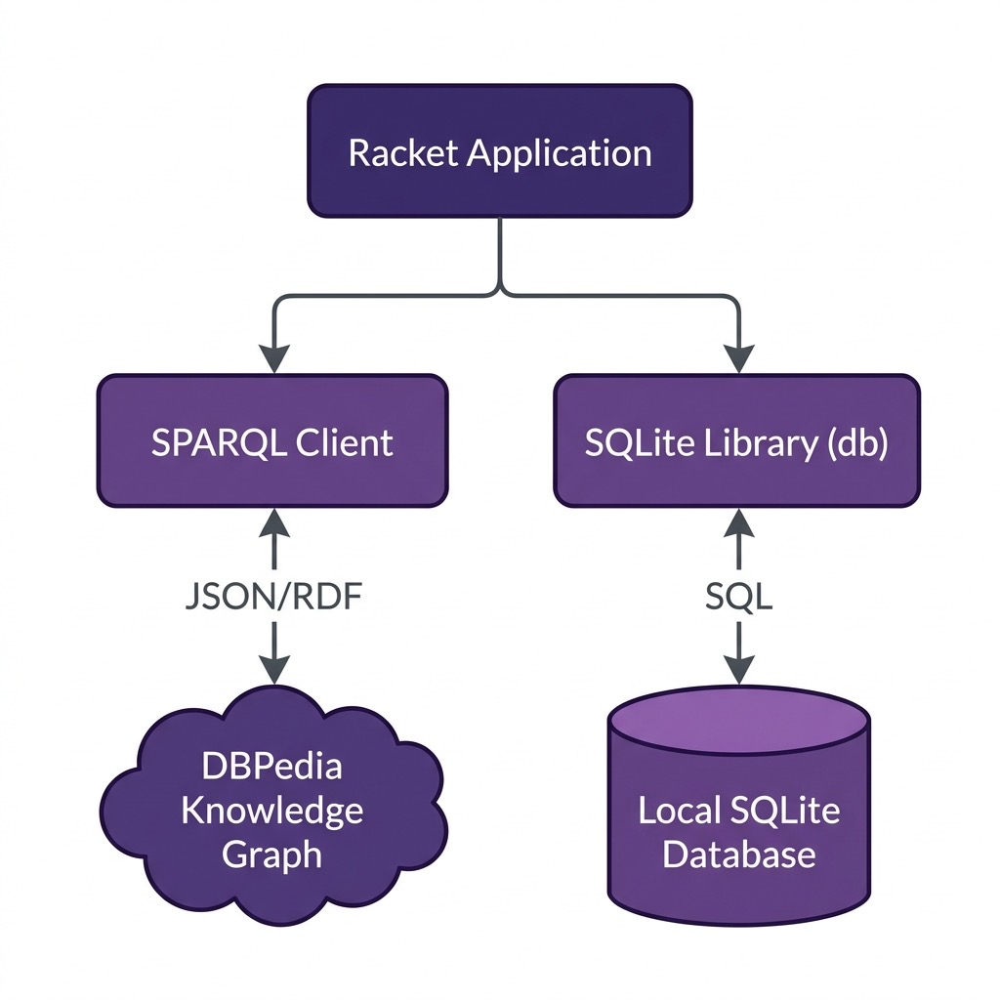

# SPARQL Queries

**Book Chapter:** [Datastores](https://leanpub.com/racket-ai/read) — *Practical Artificial Intelligence Development With Racket* (free to read online).

This project provides utilities for executing SPARQL queries against external semantic web endpoints (like DBPedia or Wikidata) directly from Racket.

## Architecture

## Run

    racket sparql.rkt
    raco test tests.rkt     # offline tests (canned JSON results, no network)

`sparql-dbpedia` returns one list per result row for any number of query variables. Names passed to `sparql-dbpedia-person-uri` and `sparql-dbpedia-place-uri` are escaped with `sparql-escape-string`. Rebind the `*sparql-endpoint*` parameter to query a different SPARQL service.

## License and Copyright

This example is released using the Apache 2 license.
Copyright 2022-2025 Mark Watson. All rights reserved.
